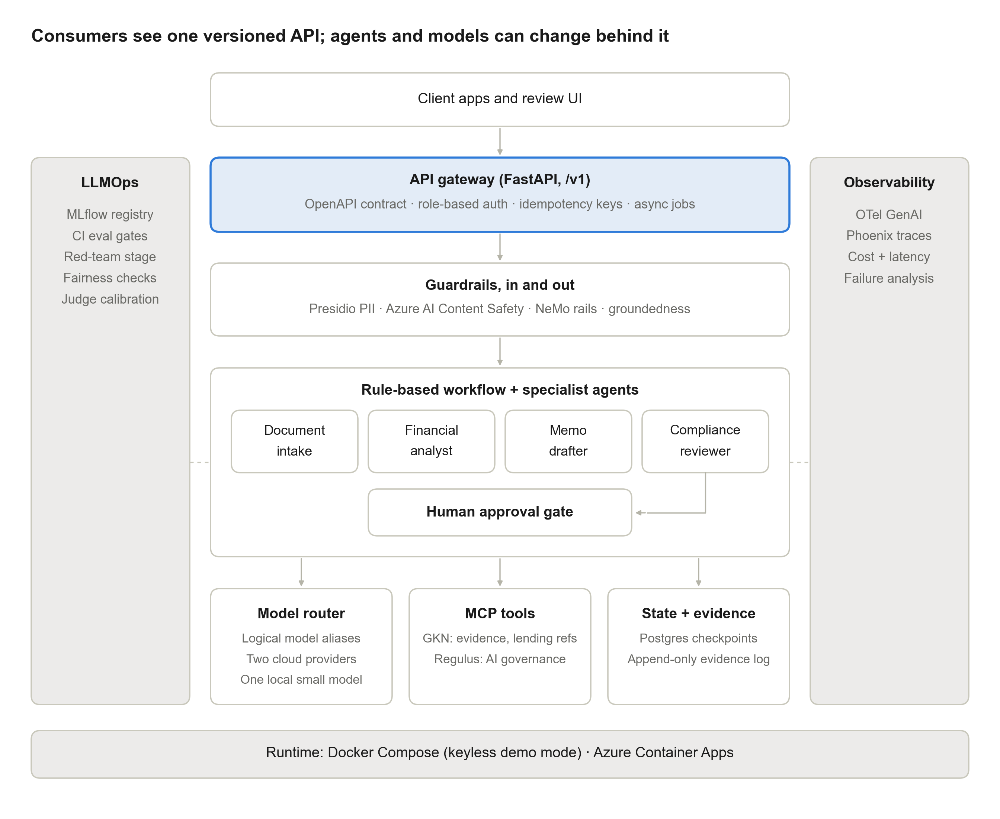
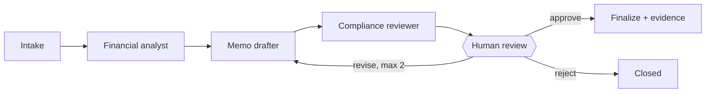
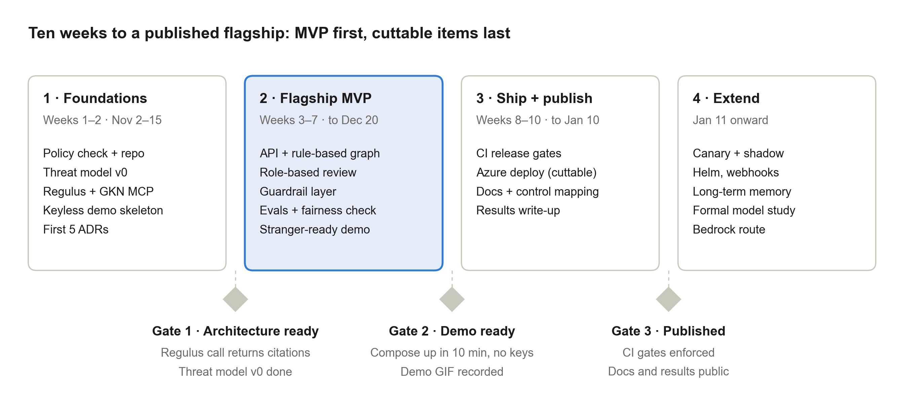

<div align="center">

# 🏛️ axiom_agent_platform

**A governed multi-agent platform for commercial lending: a versioned API, specialist agents, layered guardrails, human approval, and audit evidence for every memo.**

[](LICENSE)
[](https://www.python.org/downloads/)
[](#-status)
[](https://github.com/langchain-ai/langgraph)
[](#-data)
[](#-disclaimer)

*Submit a borrower package → get a **draft credit memo** with computed ratios, risk flags, cited policy findings, and a draft recommendation → a **credit officer decides** → every step leaves **audit evidence**.*

</div>

> **Status:** Week 5. A package goes from submission to a cited draft memo with credit policy and lending-reference findings, through layered guardrails (personal data masked, injected instructions quarantined, every number and citation checked), then waits for a credit officer to approve, reject or request a revision, in demo mode with no API keys. The evaluation baseline comes next; this page describes the target design and tracks progress against the [development plan](docs/dev-plan.md).

---

## Contents

- [What it does](#-what-it-does)
- [Design principles](#-design-principles)
- [How it works](#-how-it-works)
- [Repository structure](#-repository-structure)
- [Built on](#-built-on)
- [Governance and release gates](#-governance-and-release-gates)
- [Status](#-status)
- [Quick start](#-quick-start)
- [Roadmap](#-roadmap)
- [Documentation](#-documentation)
- [Data](#-data)
- [Disclaimer](#-disclaimer)

---

## ✨ What it does

A relationship manager submits a borrower package for a commercial term loan. The platform:

1. **Reads** the financial statements, application, and tax summary into typed data, and checks that the figures reconcile.
2. **Calculates** debt service coverage, leverage, liquidity, interest coverage, and trends with plain, unit-tested Python. The language model never does arithmetic.
3. **Drafts** a credit memo in a fixed template, with a citation behind every factual claim.
4. **Reviews** the draft against a credit policy rule engine and cited lending references.
5. **Stops** for a credit officer, who approves, rejects, or asks for a revision. The officer can't be the person who submitted the job.
6. **Records** an evidence bundle: input hashes, model and prompt versions, guardrail events, retrieved sources, trace ID, and the reviewer's decision.

The system drafts and recommends. **A human makes every credit decision.**

## 🎯 Design principles

| Principle | What it means in the code |
|---|---|
| **The API is the contract** | Consumers see jobs and memos, never model, agent, or prompt names. Everything behind `/v1` can change. |
| **LLMs reason; code calculates** | Every number in a memo is an extracted figure with a source location or a deterministic tool output, and a check verifies it. |
| **Every claim is cited and supported** | Claims are structured objects with source references; a separate check tests whether the source supports the claim. |
| **Humans decide** | No path produces a final memo without approval from an authorized reviewer who didn't submit the job. |
| **Evidence by default** | Each job writes to an append-only, hash-chained evidence log. |
| **Fail closed** | A control that can't run is recorded as *not evaluated*, never as passed. |
| **Configuration over code** | Routing, thresholds, and guardrail switches live in `config/`. |

## 🧭 How it works

<div align="center">

</div>

The workflow is a fixed LangGraph pipeline under rule-based control. That's deliberate: a credit workflow needs a repeatable path and auditable transitions.



## 🗂 Repository structure

```
axiom_agent_platform/
├── src/axiom/
│   ├── api/            # FastAPI app, /v1 routers, schemas, auth, idempotency
│   ├── jobs/           # job store and worker loop
│   ├── graph/          # LangGraph state, nodes, routing, interrupts
│   ├── agents/         # intake, analyst, drafter, compliance logic
│   ├── tools/          # deterministic ratio and policy tools
│   ├── mcp_clients/    # clients for the Regulus and GKN MCP servers
│   ├── router/         # provider adapters and routing policy
│   ├── guardrails/     # PII, content safety, rails, groundedness
│   ├── memory/         # checkpointer
│   ├── telemetry/      # OpenTelemetry setup
│   └── evidence/       # append-only evidence log and bundle writer
├── prompts/            # versioned prompt files
├── config/             # routing, guardrail, and threshold settings
├── data/
│   ├── synthetic/      # borrower packages, credit policy, golden set
│   └── lending_refs/   # public lending references + provenance manifest
├── evals/              # eval, red-team, alignment, and fairness suites
├── scripts/            # gate checks and developer tools
├── tests/              # unit, contract, and integration tests
├── infra/terraform/    # Azure resources
├── docs/               # plan, architecture, ADRs, threat model, model card
└── docker-compose.yml  # keyless local stack
```

Each folder has a short README that says what goes there and in which week of the plan.

## 🔌 Built on

The platform depends on these repositories; none of them depend on it.

| Repository | Role here |
|---|---|
| [Regulus](https://github.com/minw0607/Regulus) | MCP service: related AI governance provisions for the evidence bundle and control mapping |
| [geometric_knowledge_network](https://github.com/minw0607/geometric_knowledge_network) | MCP service: job-scoped evidence retrieval and lending references |
| [rag_eval_framework](https://github.com/minw0607/rag_eval_framework) | Quality metrics in the eval gate |
| [llm_red_teaming](https://github.com/minw0607/llm_red_teaming) | Adversarial stage in CI |
| [genai_alignment](https://github.com/minw0607/genai_alignment) | Behavioral regression scenarios |
| [multi_agent_otel_eval](https://github.com/minw0607/multi_agent_otel_eval) | OpenTelemetry helpers and token attribution |
| [genai_capability_bench](https://github.com/minw0607/genai_capability_bench) | Model-selection evidence for routing |
| [ai-governance-assurance](https://github.com/minw0607/ai-governance-assurance) | Engineering standards and control crosswalk |

## 🛡 Governance and release gates

**Regulatory position.** SR 26-2 replaced SR 11-7 in April 2026 and excludes generative and agentic AI from its scope, so this project doesn't claim to satisfy it. NIST AI RMF is the primary reference, and SR 26-2 principles are applied voluntarily by analogy.

A change can't merge if it breaks these gates. Thresholds are starting points, calibrated against measured baselines in week 6.

| Gate | Threshold |
|---|---|
| Ratio exactness | 100% |
| Extraction accuracy | Critical fields 100%; all numeric fields ≥ 98% |
| Number provenance and citation coverage | 100% |
| Citation support | ≥ 0.90 |
| Faithfulness (RAGAS) | ≥ 0.85 |
| Attack success rate | No new critical attack |
| Counterfactual consistency | Ratios, flags, and recommendation unchanged across identity-only changes |

Every LLM judge uses a different model from the one under test and is checked against hand labels.

## 📍 Status

| Milestone | Target | What it proves | State |
|---|---|---|---|
| Repository scaffold | Nov 8 | Structure, tooling, and CI in place | ✅ Done |
| **Gate 1** · Architecture ready | Nov 15 | Supporting services run without keys; Regulus returns cited provisions | ✅ Passed: checks 7/7, design docs published |
| Week 3 · First vertical slice | Nov 22 | Submit a package, poll, get a cited draft memo traced in Phoenix | ✅ Done; run live on all ten packages |
| Week 4 · Compliance and human review | Nov 29 | A job pauses for review, survives a restart, and finalizes only on approval by someone other than the submitter | ✅ Passed: checks 14/14, including a restart while a job awaits review |
| Review page (week 7 item, brought forward) | Nov 11 | A credit officer can read a draft with its findings and decide in a browser | ✅ Built |
| Week 5 · Guardrails | Dec 6 | Each control can be switched off; redaction leaves every financial value unchanged; cloud-only controls report not evaluated in demo | ✅ Passed: checks 16/16; attack success 6/20 with guardrails on vs 20/20 off ([results](evals/adversarial/v1/results.md)) |
| Week 6 · Evaluation baseline | Dec 13 | Eval report in MLflow; attack success measured with guardrails on and off; fairness results with sample size | 🟡 Golden set of 25 built; answers under review ([review page](evals/golden/v1/answers.md)) |
| **Gate 2** · Demo ready | Dec 20 | A stranger runs the demo in under 10 minutes with no API keys | ⬜ |
| **Gate 3** · Published | Jan 10 | CI gates enforced; docs and results public | ⬜ |

## 🚀 Quick start

**Tests:** install [uv](https://docs.astral.sh/uv/), then:

```bash
uv sync
uv run pytest
```

**The stack:** with [Docker](https://docs.docker.com/get-docker/) running, copy `.env.example` to `.env` and set `MCP_SHARED_SECRET` and one key per role (`SUBMITTER_API_KEYS=rm-demo:<random key>`, and likewise `REVIEWER_API_KEYS` and `AUDITOR_API_KEYS`), then:

```bash
docker compose up -d --build
uv run python scripts/check_gate1.py
uv run python scripts/check_week4.py
```

This starts Postgres, Phoenix (traces at http://localhost:6006), the OpenTelemetry Collector, the Regulus and GKN MCP servers, and the platform's API (http://localhost:8000/docs) and worker. Both MCP images are built from pinned release tags (Regulus `v0.2.1`, GKN `v0.2.0`). The check script confirms the supporting services are up, Regulus returns cited provisions, and one job's retrieval never returns another job's documents. The week 4 check submits a package, restarts Postgres, the API and the worker while the draft awaits review, then approves it and checks the evidence.

**Use the review page:** open http://localhost:8000/review and sign in with one of the role keys from `.env` (the part after the colon). A relationship manager requests a memo, a credit officer reads the draft with its findings and approves, rejects or asks for changes, and an auditor reads the audit trail. The page is plain HTML and JavaScript served by the API, with a strict content security policy; it renders everything as text.

**Or use the API directly.** Submit a package and poll for the draft:

```bash
curl -i -X POST http://localhost:8000/v1/memos -H "X-API-Key: <submitter key>" -H "Idempotency-Key: $(uuidgen)" -H "content-type: application/json" -d '{"package_id": "pkg-08"}'
curl http://localhost:8000/v1/memos/<job_id> -H "X-API-Key: <submitter key>"
```

**Review the draft** (reviewer key, `REVIEWER_API_KEYS=co-demo:<random key>`). `decision` is `approve`, `reject` or `revise`; a revision needs comments, and after two revisions the draft can only be approved or rejected. The submitter can never review their own job:

```bash
curl -i -X POST http://localhost:8000/v1/memos/<job_id>/review -H "X-API-Key: <reviewer key>" -H "Idempotency-Key: $(uuidgen)" -H "content-type: application/json" -d '{"decision": "revise", "comments": "Add a sentence on liquidity that cites the current ratio."}'
```

**Read the evidence bundle** (auditor key, `AUDITOR_API_KEYS=audit-demo:<random key>`). It lists every model call, including rejected attempts, and every job event with its hash, and reports whether the chain verifies:

```bash
curl http://localhost:8000/v1/memos/<job_id>/evidence -H "X-API-Key: <auditor key>"
```

Demo mode replays real model responses recorded from live runs, so no model API key is needed ([what the recordings are](data/recorded/README.md)). The catalog has 25 fictional packages, each built to test one scenario; the demo offers the ten with live recordings, `pkg-01` to `pkg-10`, and the other fifteen, added for the golden set in week 6, run in the tests until they are recorded live.

## 🗺 Roadmap

| Phase | Weeks | Focus |
|---|---|---|
| 1 · Foundations | 1–2 | Scaffold, threat model, Regulus and GKN as MCP services |
| 2 · Flagship MVP | 3–7 | API, agents, human review, guardrails, eval baseline, keyless demo |
| 3 · Ship and publish | 8–10 | CI release gates, Azure deployment, documentation |
| 4 · Extend | from Jan 11 | Canary and shadow routing, Helm, webhooks, long-term memory |

<div align="center">

</div>

## 📚 Documentation

- [Development plan](docs/dev-plan.md): scope, architecture, API, gates, schedule
- [Architecture](docs/architecture.md): layers, the life of a memo job, and component status
- [Architecture decision records](docs/adr/README.md): decisions and trade-offs as they're made
- [AI-assisted engineering log](docs/ai-assisted-engineering.md): what was delegated to Claude Code and what review changed
- [Threat model](docs/threat-model.md): threats, trust boundaries, and controls, mapped to the OWASP LLM and agentic Top 10 lists
- Model card and control mapping: added during the build

## 🧪 Data

All data is synthetic. Borrower packages are generated numbers-first, so every figure has a known ground truth. Lending references come from public sources, each listed with its source and retrieval date. Nothing here is legal advice or a credit decision.

## 🧾 Disclaimer

This repository is an independent personal project created outside of my employment using my own time and equipment.

The code, demonstrations, analyses, and documentation in this repository are developed independently, using only synthetic data and publicly available research, technical documentation, regulations, and other public sources. They do not rely on, incorporate, or disclose any confidential, proprietary, non-public, or client information obtained through my employment or professional engagements.

The views, designs, implementations, and conclusions expressed in this repository are solely my own and do not represent the views of any employer, client, or affiliated organization.

This repository is provided for research and educational purposes only.
