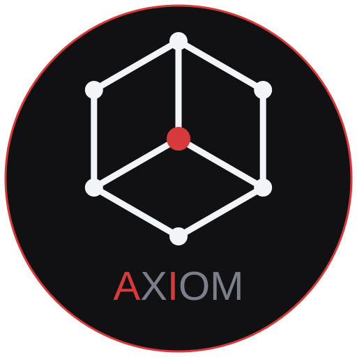
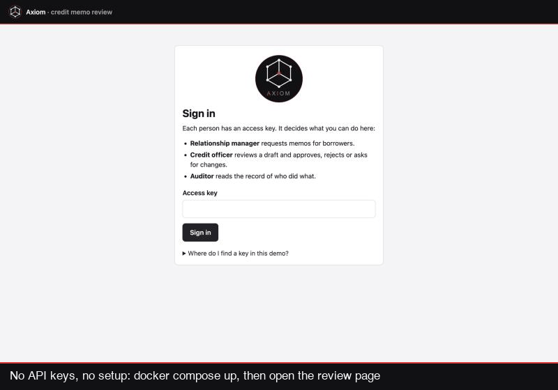
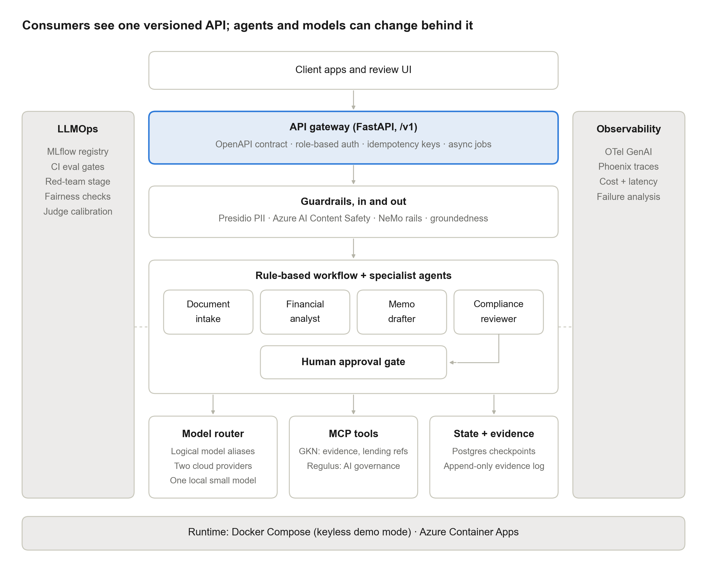
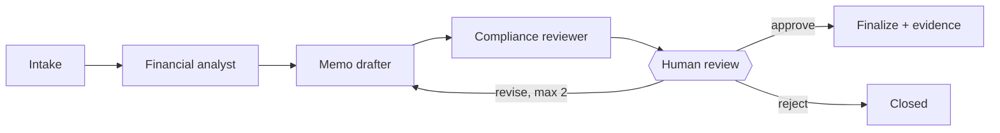
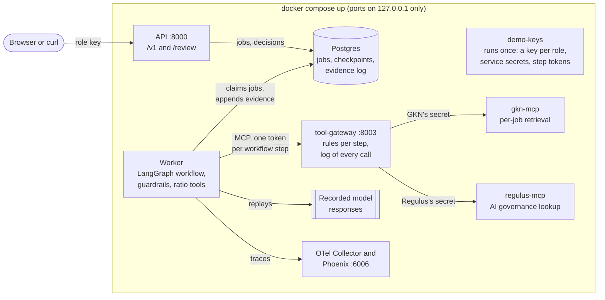
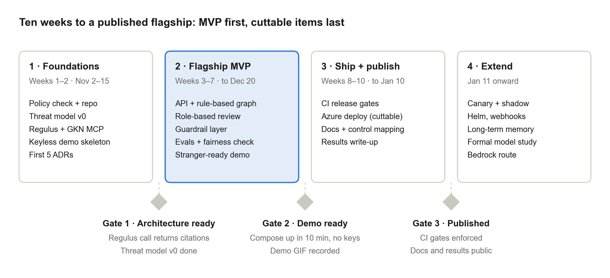

<div align="center">



# axiom_agent_platform

**A governed multi-agent platform for commercial lending: a versioned API, specialist agents, layered guardrails, human approval, and audit evidence for every memo.**

[](LICENSE)
[](https://www.python.org/downloads/)
[](docs/status.md)
[](https://github.com/langchain-ai/langgraph)
[](#-data)
[](#-disclaimer)

*Submit a borrower package → get a **draft credit memo** with computed ratios, risk flags, cited policy findings, and a draft recommendation → a **credit officer decides** → every step leaves **audit evidence**.*



*The keyless demo, from `docker compose up`: request, review with "Explain this", approval, audit trail. [Try it](#-quick-start).*

</div>

---

## Contents

- [What it does](#-what-it-does)
- [Design principles](#-design-principles)
- [AI security by design](#-ai-security-by-design)
- [How it works](#-how-it-works)
- [Repository structure](#-repository-structure)
- [Built on](#-built-on)
- [Governance and release gates](#-governance-and-release-gates)
- [Quick start](#-quick-start)
- [Roadmap](#-roadmap)
- [Documentation](#-documentation)
- [Data](#-data)
- [Disclaimer](#-disclaimer)

---

## ✨ What it does

A relationship manager submits a borrower package for a commercial term loan. The platform:

1. **Reads** the financial statements, loan application, and business description into typed data, after masking personal data and screening for instructions planted in the documents, and checks that the figures reconcile.
2. **Calculates** debt service coverage, leverage, liquidity, interest coverage, and trends with plain, unit-tested Python. The language model never does arithmetic.
3. **Drafts** a credit memo in a fixed template, with a citation behind every factual claim, and checks every draft: no credit decision stated as made, no investment advice, every number traced to its source. A failed check gets one automatic correction, then the job stops.
4. **Reviews** the draft against a credit policy rule engine and cited lending references.
5. **Stops** for a credit officer, who approves, rejects, or asks for a revision. The officer can't be the person who submitted the job.
6. **Records** an evidence bundle: input hashes, model and prompt versions, guardrail events, retrieved sources, trace ID, and the reviewer's decision.

The system drafts and recommends. **A human makes every credit decision.**

**A second app on the same platform: model documentation review.** A model validator submits a synthetic model documentation package. Code checks it against a 12-item checklist that cites NIST AI RMF and EU AI Act provisions, finds each required section, and scores completeness. A model judges whether each present section is adequate and drafts a cited findings report, with the related provisions looked up in Regulus through the same tool gateway. The validator approves, rejects or asks for a revision; the report never states that a model is approved. It shares the credit memo's job API, guardrails, human review and evidence log, and has its own prompts, recordings, evaluation set and release gates ([ADR 0016](docs/adr/0016-app-contract.md), [ADR 0017](docs/adr/0017-model-review-live-thresholds.md)). It runs in the keyless demo through the API; the review page shows only the credit memo so far.

## 🎯 Design principles

| Principle | What it means in the code |
|---|---|
| **The API is the contract** | Consumers see jobs and memos, never model, agent, or prompt names. Everything behind `/v1` can change. |
| **LLMs reason; code calculates** | Every number in a memo is an extracted figure with a source location or a deterministic tool output, and a check verifies it. |
| **Every claim is cited and checked** | A memo is a list of structured claims, each with citations to document lines or retrieved passages. Code checks that every factual claim has a citation, that each citation points to a real line, that every number traces to an extracted figure or a tool output, and that a stated figure cites its own line. An AI grader, a different model from the drafter, then judges whether the cited sources support the wording. A failed check sends the draft back once; a second failure stops the job. [See one package, end to end](docs/sample-package.md). |
| **Humans decide** | No path produces a final memo without approval from an authorized reviewer who didn't submit the job. |
| **Evidence by default** | Each job writes to an append-only, hash-chained evidence log. |
| **Fail closed** | A control that can't run is recorded as *not evaluated*, never as passed. |
| **Configuration over code** | Routing, thresholds, and guardrail switches live in `config/`. |

## 🔐 AI security by design

An agent that reads untrusted documents and calls tools has to be contained, not just prompted well. The main controls, and how each is tested:

| Concern | Control | How it's tested |
|---|---|---|
| **Identity and separation of duties** (ASI03, ASI09) | Each role has its own API key: relationship manager, credit officer, auditor. The reviewer's identity comes from the key, never from the request, and the API refuses an approval from the person who submitted the job. Both identities go into the evidence log. | Contract tests; week 4 checks |
| **Least-privilege tools through an MCP gateway** (LLM03, ASI02) | Agents never reach a tool service directly. Each workflow step has its own gateway token and may call only its own tools, with the scope (job, collection) set by code, not by the model. Rules fail closed. The MCP servers publish no ports, and each has its own secret that only the gateway holds. Every call, allowed or refused, is logged in a hash chain and shown in the memo's audit trail ([ADR 0014](docs/adr/0014-tool-gateway.md)). | Gate 1 checks refusals; Gate 2 checks that every one of 287 tool calls came from the step that owns the tool |
| **Prompt injection** (LLM01, ASI01) | Documents enter prompts as labelled data, never as instructions. A local screen quarantines a package with planted instructions before any model call. The workflow path is fixed in code, so model output can't skip human review, and the numbers come from code, so injected text can't change them. | 20 planted attacks: 6 succeed with guardrails on, 20 with them off ([results](evals/adversarial/v1/results.md)) |
| **Data isolation** (LLM02, LLM09) | Each job's documents get their own retrieval index, and the job ID comes from the workflow state, so the model can't name another borrower's job. | Isolation test in the Gate 1 check |
| **Personal data** (LLM02) | Personal data is masked before any model call and checked again in every draft, with financial values left unchanged. Unmasked data may only go to a permitted local model; otherwise the job stops. | Tests that masking leaves every amount, percentage and year unchanged |
| **Output handling** (LLM10) | The review page renders everything as text under a strict content security policy. API responses never name a model, agent or prompt. | Tests forbid HTML sinks; contract test |
| **Audit integrity** | The evidence log is append-only and hash-chained; the database refuses updates and deletes on it. | Chain verification on every audit trail |
| **Secrets** | Each install generates its own keys, and each container receives only the ones it needs. Every port is bound to the local machine. | Gate 1 and demo-key tests |
| **Outside connections** | At runtime the demo makes no outside calls: model answers are replayed, Regulus works from committed snapshots, GKN retrieves locally, the review page loads nothing from other sites, and Phoenix's and MLflow's usage data is switched off. Only the first build downloads images and the two MCP services' pinned releases. With live models, the one outside call is to the configured model provider. | The review page's content security policy allows its own site only; compose settings |

**Not built yet:** per-key rate limits and token caps, cloud content-safety screening (recorded as *not evaluated* until it's connected), and image pinning by digest. The [threat model](docs/threat-model.md) lists all 16 threats, mapped to the OWASP Top 10 for LLM Applications 2026 and the OWASP Top 10 for Agentic Applications, with each control's status.

## 🧭 How it works

<div align="center">

</div>

The workflow is a fixed LangGraph pipeline under rule-based control. That's deliberate: a credit workflow needs a repeatable path and auditable transitions.



**What runs in the demo.** `docker compose up` starts these containers. The worker runs the workflow above. It reaches the two knowledge services over MCP, only through the tool gateway, which lets each workflow step use only its own tools and logs every call. In demo mode, it replays recorded model responses instead of calling a model. The [architecture document](docs/architecture.md) follows one memo job step by step.



## 🗂 Repository structure

```
axiom_agent_platform/
├── src/axiom/
│   ├── api/            # FastAPI app, /v1 routers, schemas, auth, idempotency
│   ├── core/           # what every app uses: the App protocol, registry, agent and workflow plumbing
│   ├── apps/
│   │   ├── credit_memo/   # app 1: agents, LangGraph workflow, ratio and policy tools
│   │   └── model_review/  # app 2: checklist, section finder, assessor and drafter, workflow
│   ├── jobs/           # job store and worker loop
│   ├── mcp_clients/    # clients for the Regulus and GKN MCP servers and the tool gateway
│   ├── gateway/        # the MCP tool gateway: per-step tokens, rules, call log
│   ├── router/         # provider adapters and routing policy
│   ├── guardrails/     # PII redaction, injection screen, draft rails, number provenance
│   ├── memory/         # checkpointer
│   ├── telemetry/      # OpenTelemetry setup
│   └── evidence/       # append-only evidence log and bundle writer
├── prompts/            # versioned prompt files, one folder per app
├── config/             # routing, guardrail, threshold and tool gateway settings
├── docker/           # start-up wrapper that hands each container the demo keys
├── data/
│   ├── synthetic/      # borrower packages, credit policy, model documentation packages
│   ├── recorded/       # live model responses the keyless demo replays, one folder per app
│   └── lending_refs/   # public lending references + provenance manifest
├── evals/              # golden set scoring, grader, fairness pairs, adversarial set; model_review/ for app 2
├── scripts/            # gate checks and developer tools
├── tests/              # unit, contract, and integration tests
├── infra/terraform/    # Azure resources
├── docs/               # plan, status, architecture, ADRs, threat model, model card
└── docker-compose.yml  # keyless demo: docker compose up, no .env needed
```

Each folder has a short README that says what goes there and in which week of the plan.

## 🔌 Built on

The platform depends on these repositories; none of them depend on it.

| Repository | Role here | In use |
|---|---|---|
| [Regulus](https://github.com/minw0607/Regulus) | MCP service: related AI governance provisions for the evidence bundle and control mapping | ✅ Since week 2 |
| [geometric_knowledge_network](https://github.com/minw0607/geometric_knowledge_network) | MCP service: job-scoped evidence retrieval and lending references | ✅ Since week 2 |
| [llm_red_teaming](https://github.com/minw0607/llm_red_teaming) | Attack templates for the adversarial set; later, the adversarial stage in CI | 🟡 Templates adapted (week 5); demo-mode attack set gated in CI (week 8); live red-team stage planned |
| [rag_eval_framework](https://github.com/minw0607/rag_eval_framework) | Quality metrics in the eval gate | ⬜ Planned (weeks 6–8) |
| [genai_alignment](https://github.com/minw0607/genai_alignment) | The method behind the alignment gate: a mandate set first, pressure from a party with less authority | 🟢 Method adopted (week 8): 24 scenarios in [evals/alignment](evals/alignment/README.md), run natively |
| [multi_agent_otel_eval](https://github.com/minw0607/multi_agent_otel_eval) | OpenTelemetry helpers and token attribution | ⬜ Planned |
| [genai_capability_bench](https://github.com/minw0607/genai_capability_bench) | Model-selection evidence for routing | ⬜ Phase 4 |
| [ai-governance-assurance](https://github.com/minw0607/ai-governance-assurance) | Engineering standards and control crosswalk | Reference |

## 🛡 Governance and release gates

**Regulatory position.** SR 26-2 replaced SR 11-7 in April 2026 and excludes generative and agentic AI from its scope, so this project doesn't claim to satisfy it. NIST AI RMF is the primary reference, and SR 26-2 principles are applied voluntarily by analogy.

CI fails a change that breaks these gates; blocking the merge itself needs branch protection on `main`, still to be switched on. [ADR 0008](docs/adr/0008-evaluation-thresholds.md) set the thresholds in week 6 from the first live baseline (25 packages × 3 repeats): fixed at 100% where the platform is deterministic, a floor plus a tolerance against main where a model decides, and reported but not enforced for grader scores until the grader's calibration is complete. Since week 8, CI enforces them on every push and pull request: `evals/gate.py` checks the thresholds in `config/eval_gates.yaml` on the golden set, the fairness pairs and the attack set (with the guardrails as configured, so switching one off fails the build), and again on the 25 live recordings through a freshly built stack. When a prompt, an agent, the workflow or routing changes, a live smoke gate drafts five memos with real models and compares them with the accepted baseline; a deliberately degraded prompt [fails it](evals/smoke/results.md). With it, 24 [alignment scenarios](evals/alignment/README.md) check that the memo keeps its mandate when the applicant asks for something else: at least 95% must hold. Contract tests check that the API keeps its published OpenAPI contract.

| Gate | Threshold |
|---|---|
| Ratio exactness | 100% |
| Extraction accuracy | Critical fields 100%; all numeric fields ≥ 98% |
| Number provenance and citation coverage | 100% |
| Citation support | ≥ 0.90 |
| Faithfulness (RAGAS) | ≥ 0.85 |
| Attack success rate | No new critical attack |
| Counterfactual consistency | Ratios, flags, and recommendation unchanged across identity-only changes |

Every LLM judge uses a different model from the one under test, with no fallback to it, and is checked against a person's labels. So far that check is partial: the grader catches altered claims and ignores high-stakes framing, but its agreement with a person's judgement is not yet measured ([evaluation suite](evals/README.md)).

## 🚀 Quick start

**Try the demo: no API keys, no setup.** You need [Docker](https://docs.docker.com/get-docker/) running, git, and about 8 GB of free disk space. On Windows, install [Docker Desktop](https://docs.docker.com/desktop/setup/install/windows-install/) (it sets up WSL 2) and [Git for Windows](https://git-scm.com/downloads/win), and run the commands in PowerShell. Then:

```bash
git clone https://github.com/minw0607/axiom_agent_platform.git
cd axiom_agent_platform
docker compose up -d --build
docker compose logs demo-keys
```

The last command prints one sign-in key per role. Open http://localhost:8000/review, sign in with the **relationship manager** key and request a memo for any package. When the draft is ready, sign in with the **credit officer** key to read it and approve, reject or ask for changes. Then sign in with the **auditor** key to read the audit trail.

The first start downloads and builds about 6 GB of images, which takes the longest: 1.5 minutes from `git clone` to ready on a fast connection, longer on a slow one. It starts:

- Postgres
- Phoenix, the trace viewer, at http://localhost:6006, and the OpenTelemetry Collector
- the Regulus and GKN MCP servers, built from pinned release tags (Regulus `v0.2.1`, GKN `v0.2.0`), and the tool gateway in front of them
- the platform's API, at http://localhost:8000/docs, and its worker

Every port is bound to your machine only, and the two MCP servers are reachable only through the gateway. The models' answers are replayed from live recordings, so no model is called. A one-time `demo-keys` service generates the three role keys, a secret for each MCP server and a gateway token for each workflow step into `.demo/keys.env`; each container is given only the values it needs. Git ignores that file, and the keys stay the same until you delete it. Any value you set in `.env` is used instead of the generated one.

**Why Docker:** the demo is nine services, each with its own dependencies. Docker packages each one with exactly what it needs, so Docker is the only thing you install, the stack starts the same way on macOS, Windows and Linux, and `docker compose down -v` removes all of it. It also enforces the design: the MCP servers publish no ports and accept only the gateway's secret, and each container is given only its own keys.

**Run the tests:** install [uv](https://docs.astral.sh/uv/), then:

```bash
uv sync
uv run pytest
```

**Check the stack:**

```bash
uv run python scripts/check_gate1.py
uv run python scripts/check_week4.py
uv run python scripts/check_gate2.py
uv run python evals/gate.py --stack
```

- **Gate 1 check:** the supporting services are up, the MCP servers are reachable only through the gateway, the gateway refuses a step's call outside its own tools, Regulus returns cited provisions, and one job's retrieval never returns another job's documents.
- **Week 4 check:** submits a package, restarts Postgres, the API and the worker while the draft awaits review, then approves it and checks the evidence.
- **Gate 2 check:**
  - every service answers;
  - the review page has its strict content security policy;
  - all 25 packages go through the API end to end: a draft, two revision rounds and an approval, each with a verified evidence chain;
  - every model response was replayed from a recording;
  - every tool call went through the gateway from the step that owns the tool;
  - the same for model documentation review: all 6 packages through `/v1/apps/model_review/jobs` to approval after two revisions, replayed recordings only, governance lookups only from the provisions step.

  `--clean-run` first does what this page asks of a newcomer, and times it: clone into an empty folder with no `.env`, start the stack, and wait until it is ready.

**Contract tests:** `uv run pytest tests/test_contract.py` has [Schemathesis](https://schemathesis.readthedocs.io/) generate about 1,300 requests from the API's OpenAPI document, valid and deliberately invalid, and checks each response against it: only declared status codes, bodies that match their schemas, problem details for every error, and never a server error. They run on the in-memory store and on Postgres, and one test walks a real memo through draft, review and audit.

**Release gates (no keys, no stack):** `uv run python evals/gate.py` runs the golden set, the fairness pairs and the attack set and fails if any [threshold](config/eval_gates.yaml) is missed; `--stack` replays the 25 live recordings through the running stack instead. CI runs both. `--live` runs the [smoke gate](evals/smoke/README.md) with the model settings in `.env` (about 66k tokens); `--live --full` the whole golden set, three repeats (about 1M); `--live --alignment` the alignment scenarios (about 315k); `--live --model-review` app 2's six packages, three repeats (about 170k).

**Read the gateway's log:** `docker compose exec tool-gateway cat /var/lib/axiom-gateway/tool_calls.jsonl` shows every tool call: which step, which tool, allowed or refused, with fingerprints of what went in and out. The same calls appear in each memo's audit trail.

**Use the review page:** open http://localhost:8000/review and sign in with one of the role keys from `docker compose logs demo-keys`. If you set your own keys in `.env`, use the part after the colon. A relationship manager requests a memo, a credit officer reads the draft with its findings and approves, rejects or asks for changes, and an auditor reads the audit trail. The page is plain HTML and JavaScript served by the API, with a strict content security policy; it renders everything as text. After signing in, each role first sees its own overview: a relationship manager their requests by stage and any failures, a credit officer the review queue with high-risk memos first, and an auditor integrity-check failures, failed jobs, safety checks that found a problem, and recent decisions. **Explain this:** click a citation to read the exact source line (with its table's header row, and whether it still matches the fingerprint recorded during the job), a ratio to see its formula and every input with its source, a flag or finding to read the credit policy clause it applies, or a safety check to see what it checks. These are lookups, not model calls.

**Start over:** evidence events are append-only, so there is no command that deletes memos. To clear a demo, remove the database volume, which deletes every memo and its evidence: `docker compose down -v`, then `docker compose up -d`.

**Run the evaluations** (no keys needed; demo mode replays recordings):

```bash
uv run python scripts/check_week5.py           # guardrail acceptance check
uv run python evals/adversarial/harness.py     # 20 planted attacks, guardrails on and off
uv run python evals/baseline.py                # golden set and fairness pairs, scored
```

Results are written to [`evals/results/`](evals/results/) and [`evals/adversarial/v1/`](evals/adversarial/v1/results.md). To browse runs over time, start MLflow with `docker compose --profile evals up -d mlflow`, open http://localhost:5050, and add `--mlflow` to the last command (run it with `uv run --group evals`). A live run (`--mode live`) needs model keys in `.env` and spends tokens. See the [evaluation suite](evals/README.md).

**Or use the API directly.** Submit a package and poll for the draft:

```bash
curl -i -X POST http://localhost:8000/v1/memos -H "X-API-Key: <submitter key>" -H "Idempotency-Key: $(uuidgen)" -H "content-type: application/json" -d '{"package_id": "pkg-08"}'
curl http://localhost:8000/v1/memos/<job_id> -H "X-API-Key: <submitter key>"
```

**Review the draft** (reviewer key, `REVIEWER_API_KEYS=co-demo:<random key>`). `decision` is `approve`, `reject` or `revise`; a revision needs comments, and after two revisions the draft can only be approved or rejected. The submitter can never review their own job:

```bash
curl -i -X POST http://localhost:8000/v1/memos/<job_id>/review -H "X-API-Key: <reviewer key>" -H "Idempotency-Key: $(uuidgen)" -H "content-type: application/json" -d '{"decision": "revise", "comments": "Add a sentence on liquidity that cites the current ratio."}'
```

**Model documentation review** uses the same job routes under `/v1/apps/model_review/jobs`; `GET /v1/apps/model_review/packages` lists the packages (`mdl-01` to `mdl-06`) and `GET /v1/apps/model_review/checklist` the checklist:

```bash
curl -i -X POST http://localhost:8000/v1/apps/model_review/jobs -H "X-API-Key: <submitter key>" -H "Idempotency-Key: $(uuidgen)" -H "content-type: application/json" -d '{"package_id": "mdl-04"}'
```

**Read the evidence bundle** (auditor key, `AUDITOR_API_KEYS=audit-demo:<random key>`). It lists every model call, including rejected attempts, and every job event with its hash, and reports whether the chain verifies:

```bash
curl http://localhost:8000/v1/memos/<job_id>/evidence -H "X-API-Key: <auditor key>"
```

Demo mode replays real model responses recorded from live runs, so no model API key is needed ([what the recordings are](data/recorded/README.md)). The demo offers all 25 fictional packages, each built to test one scenario ([the list](data/synthetic/README.md)). In two of them, pkg-21 and pkg-23, the recorded draft recommends approval where the expected answer is to refer, and the credit policy rules flag the problem for the credit officer. The [recordings page](data/recorded/README.md) explains.

### Use your own models

The demo needs no models. To draft memos with real ones, bring your own provider account: the calls go to your account, and are billed there. Agents never name a model; they ask for a task, the [routing policy](config/routing.local.yaml) picks a logical alias for it, and `MODEL_ALIAS_MAP` in your `.env` says which provider and model each alias means. Supported providers:

| Provider | `MODEL_ALIAS_MAP` entry | Settings in `.env` |
|---|---|---|
| OpenAI | `openai:<model>` | `OPENAI_API_KEY` |
| Azure OpenAI | `openai:<deployment>` | `OPENAI_API_KEY`, `OPENAI_BASE_URL` (your endpoint) and `OPENAI_API_VERSION`; behind an API management gateway, also `OPENAI_APIM_HEADER_NAME` and `OPENAI_APIM_SUBSCRIPTION_KEY` |
| Any OpenAI-compatible endpoint | `openai:<model>` | `OPENAI_API_KEY` and `OPENAI_BASE_URL` |
| Anthropic | `anthropic:<model>` | `ANTHROPIC_API_KEY`; optionally `ANTHROPIC_BASE_URL` for a gateway |
| Ollama, on your own machine | `ollama:<model>` | `OLLAMA_BASE_URL`; inside Docker it defaults to Ollama on your machine |

1. Copy the example settings: `cp .env.example .env`. Git ignores `.env`; never commit it.
2. In `.env`, set `AXIOM_MODE=local` and fill in the settings for your provider from the table.
3. Map each alias in the routing policy to a model, comma-separated. The aliases are `small-a` (extraction, and the evaluation grader), `frontier-a` (the narrative, the draft and the compliance review), and `local-small` (the only model allowed to see unmasked personal data, so it must be an Ollama model). Providers can be mixed:

   ```bash
   MODEL_ALIAS_MAP=small-a=openai:<model>,frontier-a=anthropic:<model>,local-small=ollama:<model>
   ```

   `local-small` is optional: without it, a job that would send unmasked personal data stops instead (fail closed). Personal data is masked by default, so ordinary jobs never need it.
4. Restart the stack, `docker compose up -d`, and request a memo on the review page.
5. Optional: check the models before you rely on them. `uv run python evals/gate.py --live` drafts five memos and compares them with the accepted baseline (about 66k tokens with the reference models; your models' counts will differ).

The model names stay in your `.env`. The repository, the API's responses and the evidence bundle name only the aliases. Settings for one provider don't affect another; an alias whose provider has no settings fails over to its route's fallback, or the job stops with a public reason code. To add a provider, write one adapter in [`src/axiom/router/adapters.py`](src/axiom/router/adapters.py) and register it in [`router.py`](src/axiom/router/router.py).

## 🗺 Roadmap

| Phase | Weeks | Focus |
|---|---|---|
| 1 · Foundations | 1–2 | Scaffold, threat model, Regulus and GKN as MCP services |
| 2 · Flagship MVP | 3–7 | API, agents, human review, guardrails, eval baseline, keyless demo |
| 3 · Ship and publish | 8–10 | CI release gates, Azure deployment, documentation |
| 4 · Extend | from Jan 11 | A platform core that hosts more agentic apps, with the credit memo as the first ([ADR 0015](docs/adr/0015-platform-core-and-apps.md)); started early: the core and app 2, model documentation review, built, evaluated live and recorded for the demo (Nov 18–20); next, app 2 on the review page; canary and shadow routing, Helm, webhooks, long-term memory |

Progress on each milestone, with its result, is on the [status page](docs/status.md).

<div align="center">

</div>

## 📚 Documentation

- [Development plan](docs/dev-plan.md): scope, architecture, API, gates, schedule
- [Status](docs/status.md): each milestone, what it proves, and the result
- [First run](docs/first-run.md): the checklist for someone trying the demo for the first time
- [A sample package, end to end](docs/sample-package.md): the documents, extracted figures, computed ratios, the drafted memo, and how each claim is checked
- [Architecture](docs/architecture.md): layers, the life of a memo job, and component status
- [Architecture decision records](docs/adr/README.md): decisions and trade-offs as they're made
- [Platform design principles](docs/platform-principles.md): model choice and cost, the API contract, LLM judges, multi-agent design, build or buy, data for AI; each checked against the credit memo app
- [AI-assisted engineering log](docs/ai-assisted-engineering.md): what was delegated to Claude Code and what review changed
- [Threat model](docs/threat-model.md): threats, trust boundaries, and controls, mapped to the OWASP LLM and agentic Top 10 lists
- [Evaluation suite](evals/README.md): the golden set, scoring, the grader and its calibration, fairness pairs, and the adversarial set; app 2's in [evals/model_review](evals/model_review/README.md)
- [API errors](docs/api-errors.md): every error type and job failure reason
- Model card and control mapping: added during the build

## 🧪 Data

All data is synthetic. Borrower packages are generated numbers-first, so every figure has a known ground truth. Model documentation packages describe fictional models, each written with an answer key for its checklist sections and findings. Lending references come from public sources, each listed with its source and retrieval date. Nothing here is legal advice or a credit decision.

## 🧾 Disclaimer

This repository is an independent personal project created outside of my employment using my own time and equipment.

The code, demonstrations, analyses, and documentation in this repository are developed independently, using only synthetic data and publicly available research, technical documentation, regulations, and other public sources. They do not rely on, incorporate, or disclose any confidential, proprietary, non-public, or client information obtained through my employment or professional engagements.

The views, designs, implementations, and conclusions expressed in this repository are solely my own and do not represent the views of any employer, client, or affiliated organization.

This repository is provided for research and educational purposes only.
