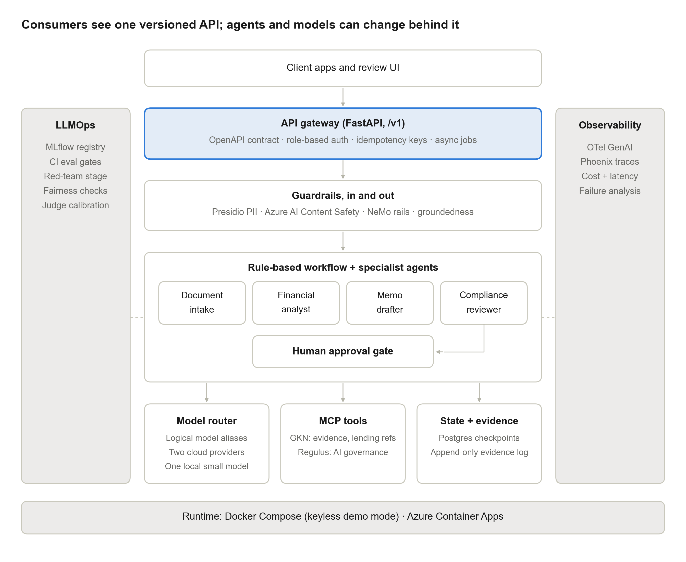
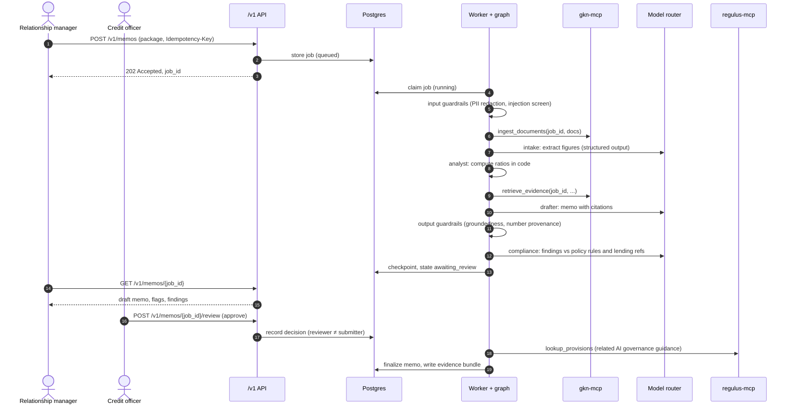
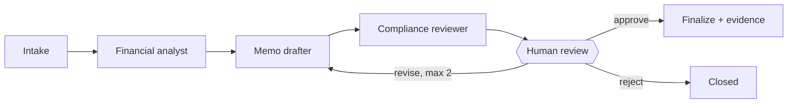

# Architecture

This document explains how the platform is put together: its layers, how a memo job flows through them, and where each piece lives in the code. The [development plan](dev-plan.md) holds the full specification; the [ADRs](adr/README.md) hold the reasoning behind each decision; the [threat model](threat-model.md) covers what can go wrong.

**Status (Nov 12, 2026):** the supporting services pass the Gate 1 check, and the first vertical slice runs under `docker compose`: the API accepts a package, the worker runs intake, analyst and drafter, and polling returns a cited draft, traced in Phoenix. Every draft is checked against the credit policy by a deterministic rule engine and reviewed by a compliance agent against cited lending references (Regulation B and OCC guidance), and every job writes a hash-chained evidence log that auditors read through the evidence endpoint. A credit officer then approves, rejects or requests a revision through the review endpoint; the job pauses at a LangGraph interrupt and its state is kept by the Postgres checkpointer, so it survives a worker restart. Layered guardrails run at intake and on every draft, each switchable in config and recorded in the evidence chain; week 5's acceptance check passes 16/16. The evaluation baseline follows. Section 7 tracks each component.

## 1. Overview

Requests flow top to bottom through five layers. Observability and evidence cut across all of them.

| Layer | What it does | Code |
|---|---|---|
| **API** | The stable `/v1` contract: jobs, memos, reviews, evidence. Authentication, roles, rate limits, idempotency | `src/axiom/api/` |
| **Jobs** | Job records and the worker loop that runs the workflow | `src/axiom/jobs/` |
| **Workflow** | A fixed LangGraph pipeline of specialist agents, with a human review pause | `src/axiom/graph/`, `src/axiom/agents/` |
| **Controls** | Guardrails at input, generation, output and process stages | `src/axiom/guardrails/` |
| **Capabilities** | Model router, deterministic tools, MCP services | `src/axiom/router/`, `src/axiom/tools/`, `src/axiom/mcp_clients/` |
| Cross-cutting | Telemetry, evidence log, checkpointed memory | `src/axiom/telemetry/`, `src/axiom/evidence/`, `src/axiom/memory/` |

Three rules shape everything:

1. **The API is the contract.** Clients see jobs and memos. They never see model, agent or prompt names; those appear only in the auditor-only evidence endpoint. Everything behind `/v1` can change without breaking clients.
2. **LLMs reason; code calculates.** Models extract, write and review. Every number comes from extraction with a source location or from a deterministic tool.
3. **Humans decide.** The workflow cannot finalize a memo without approval from an authorized reviewer who did not submit it.

## 2. A memo job, end to end

Every step writes OpenTelemetry spans (traces go to Phoenix) and evidence-log events.

## 3. The workflow

| Node | Does | Uses a model for | Uses code for |
|---|---|---|---|
| Intake | Parses documents into a typed `BorrowerPackage` and indexes them for this job only | Extracting figures (structured output) | Parsing; reconciliation (balance sheet balances, totals foot) |
| Financial analyst | Ratios, trends, risk flags, narrative | Narrative only | DSCR, leverage, liquidity, interest coverage, trends |
| Memo drafter | Fixed-template memo with a citation for every claim | Writing | Retrieval of evidence through GKN |
| Compliance reviewer | Findings with severity | Judging the draft against retrieved references | Credit policy rule engine |
| Human review | Pause until a reviewer acts | None | LangGraph interrupt, resumed by the review endpoint |
| Finalize | Stores the memo and evidence bundle | None | Evidence writer; Regulus lookup (informational) |

A rule-based supervisor, written in code with no LLM, chooses each transition, so the path is repeatable and auditable ([ADR 0001](adr/0001-orchestration-framework.md), [ADR 0011](adr/0011-workflow-control.md)). Graph state is checkpointed in Postgres by `job_id`, so a job can wait at review for days and survive restarts.

**Loops are bounded.** A human can send a draft back for revision at most twice; after that, only approve or reject. An output-guardrail failure sends the draft back once as an automated fix; a second failure fails the job.

## 4. Controls

Guardrails run where each risk appears ([ADR 0004](adr/0004-guardrail-placement.md)):

| Stage | Controls |
|---|---|
| Input | PII redaction (financial values unchanged); prompt-injection screen on documents |
| Generation | Rails: no final-decision language, no investment advice, stay on task |
| Output | Groundedness and citation support; number provenance; harm categories; PII on output |
| Process | Human approval before finalize, from a reviewer who did not submit; cannot be switched off |

Each check returns `passed`, `triggered` or `not_evaluated`, emits a span and an evidence event, and can be toggled in `config/guardrails.yaml` (except human approval) so its effect can be measured. A check that cannot run never reports a pass.

## 5. Capabilities

**Model router** ([ADR 0005](adr/0005-model-routing.md)). Agents ask for a task route (`extraction`, `narrative`, `compliance`), never a model. The router resolves logical aliases from environment settings, applies sensitivity rules first (unredacted PII only to a permitted local model, otherwise fail closed), then the task route, then fallback. Adapters: Azure OpenAI, Anthropic, Ollama, and `recorded` for the keyless demo. Every call returns a `RoutingDecision` for the evidence bundle.

**Deterministic tools** ([ADR 0003](adr/0003-tool-integration.md)). Ratio math and policy rules are plain Python in `src/axiom/tools/`, called in-process and unit-tested to 100% exactness.

**MCP services** ([ADR 0003](adr/0003-tool-integration.md)). Two sibling repositories run as separate containers over streamable HTTP, behind a shared bearer secret, with host-header checks:

| Service | Tools | Role |
|---|---|---|
| gkn-mcp (geometric_knowledge_network v0.2.0) | `ingest_documents`, `retrieve_evidence`, `delete_job` | Job-scoped evidence; read-only `credit_policy` and `lending_refs` collections. Each job has its own index, so isolation is structural |
| regulus-mcp (Regulus v0.2.1) | `lookup_provisions`, `recommend_mitigants` | Related AI governance provisions for the evidence bundle. Runs offline from committed snapshots |

The platform sets scope arguments such as `job_id` from graph state; a model never chooses them. Regulus covers AI governance, not lending regulation, so it never reviews memo content ([ADR 0012](adr/0012-regulatory-position.md)).

## 6. Data, evidence and observability

**Postgres** holds three things: job records and idempotency keys, LangGraph checkpoints, and the evidence log.

**The evidence log** is append-only and hash-chained (SHA-256). For each memo the bundle records: input hashes, retrieved source hashes, policy version, model aliases and prompt versions, routing decisions, guardrail events, trace ID, image tag, and the reviewer's decision with both identities. The auditor-only endpoint returns the bundle and verifies the chain.

**Telemetry** follows the OpenTelemetry GenAI conventions: spans for each request, graph run, node, model call, tool call and guardrail check, with tokens, cost, latency and outcome. Locally the Collector forwards to Phoenix (`http://localhost:6006`); in the cloud it forwards to Azure Monitor. Traces carry IDs and counts, not document text.

**Data** is synthetic throughout: generated borrower packages with known ground truth, a fictional credit policy, and public lending references with a provenance manifest.

## 7. Deployment and component status

| Environment | Runtime | Notes |
|---|---|---|
| Local | Docker Compose (`docker-compose.yml`) | Keyless by default. All ports bound to 127.0.0.1. MCP images built from release tags |
| Cloud demo (week 9) | Azure Container Apps, Postgres Flexible Server, ACR, Key Vault, Log Analytics; Terraform | Catalog-only public access, no uploads, daily job cap. No local model in the cloud, so unredacted-PII routes fail closed |
| Kubernetes (phase 4) | kind + Helm | Packaging demonstration only |

| Component | Status |
|---|---|
| Postgres, Phoenix, OTel Collector | Running in compose |
| regulus-mcp, gkn-mcp | Running in compose; Gate 1 check passes 7/7 |
| MCP client (`MCPToolClient`), GKN evidence client | Built and tested |
| `/v1/memos` submit and poll, job store (Postgres), idempotency, problem+json, role keys | Built and tested (week 3) |
| Worker, LangGraph workflow (intake → analyst → drafter), rule-based supervisor | Built and tested (week 3) |
| Ratio, policy-flag and reconciliation tools | Built; exact against an independent reference on all 10 packages |
| Router v1: recorded adapter (demo), OpenAI and Azure OpenAI adapter, fallback, fail-closed sensitivity rule | Built; run live on all ten packages, whose responses the demo replays |
| Telemetry: API, job, workflow, node and model-call spans to Phoenix | Built (week 3) |
| Synthetic data v1: 10 packages, credit policy, ground truth | Built (week 3) |
| Evidence log: per-job hash chain in Postgres (append-only by trigger), every model attempt including rejected ones, auditor-only `GET /v1/memos/{id}/evidence` with chain verification | Built and tested (week 4) |
| Credit policy rule engine: 14 deterministic checks of the draft against CP-2026.2, each `passed`, `triggered` or `not_evaluated`, shown with the memo and in the evidence bundle | Built and tested (week 4) |
| Compliance reviewer: answers fixed topics (prohibited basis, repayment capacity, adverse-action reasons for a draft decline) against lending references retrieved through GKN, citing the passages; fails closed to `not_evaluated` | Built and tested (week 4) |
| Lending references: Regulation B excerpts and OCC Rating Credit Risk passages, quoted exactly, with a provenance manifest checked by test | Built (week 4) |
| Human review: LangGraph interrupt after compliance; `POST /v1/memos/{id}/review` (reviewer role, idempotent); the submitter cannot review their own job; at most two human revisions, counted apart from automated fixes; reject ends the job, and only an approval reaches finalize | Built and tested (week 4) |
| Postgres checkpointer keyed by job_id, with deserialization limited to an allowlist of the platform's state types; a paused job resumes in a new worker process | Built and tested (week 4) |
| Finalize: hashes the approved draft and attaches related AI governance provisions from Regulus to the evidence bundle, labeled related guidance; a failed lookup is `not_evaluated` and never blocks approval | Built and tested (week 4) |
| Week 4 acceptance: `scripts/check_week4.py` restarts Postgres, the API and the worker while a job is paused, then approves it | Passing (Nov 11) |
| Review page at `/review`: static HTML and JavaScript served by the API, text-only rendering under a strict content security policy; requests, review decisions and the audit trail by role; `GET /v1/me`, `GET /v1/packages`, `GET /v1/memos` | Built and tested (brought forward from week 7) |
| Guardrail framework: one interface (`passed`, `triggered`, `not_evaluated`), switches in `config/guardrails.yaml`, a span and a `guardrail_checked` evidence event per check, results in the memo and the evidence bundle; a control switched off or failing records `not_evaluated` | Built and tested (week 5) |
| Input guardrails: Presidio PII redaction (financial values never changed; unredacted content routes as `pii_unredacted`) and a local injection screen that quarantines the package before any model call | Built and tested (week 5) |
| Draft guardrails: three rails (decision language, investment advice, on task) and two evidence checks (number provenance, citation support) on every draft; one automated fix (`drafter_fix/v1`), counted apart from human revisions, then the job fails with `guardrail_failed` | Built and tested (week 5) |
| PII on output (`pii_output`) and harm categories (`content_safety`, cloud-only: `not_evaluated` until the client is connected) | Built and tested (week 5) |
| Adversarial set v1: 20 attacks run with guardrails on and off; attack success 6/20 on, 20/20 off (`evals/adversarial/`) | Built (week 5) |
| Golden set v1: 25 packages with expected flags, acceptable recommendations and key findings, derived from the policy text and checked against the flag tool; draft until reviewed (`evals/golden/v1/answers.md`) | Built (week 6) |
| Evaluation runner (`evals/baseline.py`): golden set and 20 counterfactual pairs, scored on the plan's gate metrics, demo or live, logged to MLflow (optional compose profile `evals`, port 5050) | Built (week 6); demo and live baselines committed |
| Week 6 acceptance: `scripts/check_week6.py`, a live golden run in MLflow, attack success on and off, counterfactual results with sample size, ADR 0008 | Passing (Nov 13) |
| Evaluation grader (`evals/judge/`): citation support and key-finding coverage on the router's `judge` route, a different model from the drafter with no fallback; 30-item calibration set labelled blind by a person; agreement, kappa and a stakes-framing check | Built (week 6); calibration awaits labels and a live run |
| Week 5 acceptance: `scripts/check_week5.py`, every control toggled, redaction invariants, cloud-only `not_evaluated`, the adversarial set, and guardrail events in a stack job's chain | Passing (Nov 12) |
| Eval baseline | Week 6 |
| Keyless demo | Week 7 |
| CI release gates | Week 8 |
| Cloud deployment | Week 9 |

## 8. Decisions

| ADR | Decision |
|---|---|
| [0001](adr/0001-orchestration-framework.md) | LangGraph, fixed pipeline, logic outside the graph module |
| [0002](adr/0002-api-interaction-model.md) | Async jobs with polling; webhooks in phase 4 |
| [0003](adr/0003-tool-integration.md) | MCP for sibling services; in-process calls for deterministic tools |
| [0004](adr/0004-guardrail-placement.md) | Layered guardrails at four stages |
| [0005](adr/0005-model-routing.md) | Thin in-house router with logical aliases |
| [0006](adr/0006-memory-architecture.md) | Postgres checkpointer keyed by job_id; long-term memory deferred until its controls exist |
| [0007](adr/0007-deterministic-computation.md) | Code computes; models extract and write; every figure checked against its source line |
| [0011](adr/0011-workflow-control.md) | Rule-based supervisor in code; no model decides the path |
| [0012](adr/0012-regulatory-position.md) | NIST AI RMF primary; SR 26-2 by analogy; rule engine plus cited lending references |

The remaining ADRs (0008–0010) are written in the week each decision is made.
