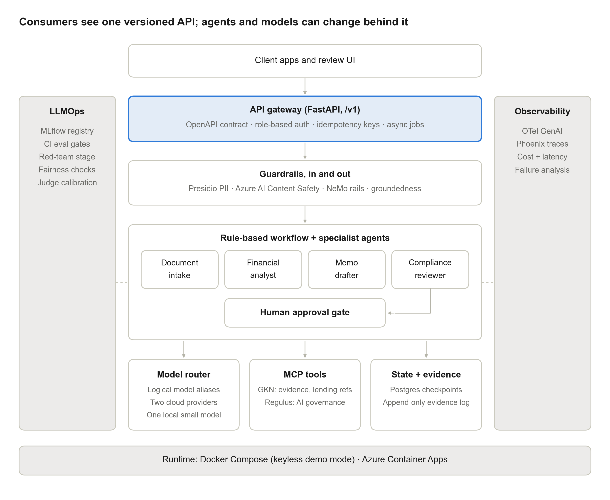
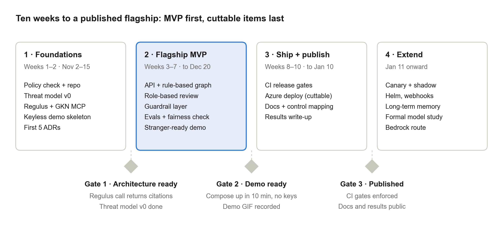

# axiom_agent_platform: development plan

*A governed multi-agent platform for financial services*

**Author:** Min Wu

**Version:** 1.1, November 2, 2026

**Status:** Draft for implementation in Claude Code

**Repository:** github.com/minw0607/axiom_agent_platform

This file is generated from the plan document; edit the plan, not this file, when both exist.

## Changes in version 1.1

1. Regulatory position: SR 26-2 is applied by analogy, not claimed as a requirement. See section 1.4.
2. Compliance knowledge: Regulus keeps its AI governance role. Memo review now uses the credit policy rule engine and a small cited lending reference set.
3. Schedule: Gate 2 moves from December 13 to December 20. Non-MVP items move to phase 4, and each phase has an hour budget, with a cut order.
4. Stranger test: docker compose up now runs a keyless demo mode.
5. Cloud design: worker scaling, the local-model gap, Postgres cost, and catalog-only public access are now specified.
6. Accuracy controls: extraction accuracy, number provenance, and citation support join the release gates.
7. Accountability: reviewer roles, separation of duties, a hash-chained evidence log, fairness pairs, and a human oversight test are added.
8. Gate reliability: PR checks and nightly statistical decisions are separated, and LLM judges must be independent and calibrated.
9. Risk reduction: long-term memory, webhooks, canary routing, and Kubernetes move to phase 4.

## 1. Executive summary

axiom_agent_platform is a deployable reference implementation of a governed agentic AI platform for commercial lending. A LangGraph workflow of specialist agents under rule-based control gathers borrower documents, computes financial ratios, drafts a credit memo, checks it against credit policy and cited lending references, and routes it to a human approver. Every request passes through a versioned API, layered guardrails, full OpenTelemetry tracing, and CI release gates for quality and safety.

The platform has two purposes. It is a working product that demonstrates end-to-end AI engineering (APIs, orchestration, deployment, LLMOps), and it is the integration point for eight existing repositories, which become reusable components rather than standalone research projects.

### 1.1 Objectives

1. Ship a containerized multi-agent workflow that a stranger can run without API keys, then deploy it to a public demo endpoint.
2. Demonstrate enterprise API design: versioned contracts, idempotency, async jobs, and decoupling of consumers from model and workflow topology.
3. Implement LLMOps release controls: prompt and model versioning and evaluation and red-team gates in CI, with shadow and canary routing in phase 4.
4. Show governance built into the architecture: guardrails, human-in-the-loop, audit evidence, and a control mapping built on NIST AI RMF, with SR 26-2 principles applied by analogy.
5. Produce reusable architecture assets: reference architecture, ADRs, engineering standards, threat model, model card.

### 1.2 Success criteria

| Criterion | Measure | Target |
|---|---|---|
| Runs for a stranger | Clean clone to keyless demo with docker compose up | Under 10 minutes |
| Deployed | Public HTTPS endpoint on Azure Container Apps | Live; apps scale to zero, database under a budget cap |
| CI quality | Pipeline green on main with eval and red-team gates enforced | 100% of merges |
| Deterministic math | Ratio calculations match golden set exactly | 100% |
| Extraction accuracy | Numeric fields extracted from documents match the golden set | Critical fields 100%; all numeric fields at least 98% |
| Number provenance | Every number in a memo traces to an extracted figure or tool output | 100% |
| Grounded memos | Faithfulness (RAGAS) on golden set | Initial target 0.85; calibrate in week 6 |
| Safety | Attack success rate, guardrails on vs. off | Measured and reported; reduction shown |
| Fair treatment | Counterfactual pairs with identical financials and changed owner identity signals | Ratios, flags, and recommendation unchanged; sample size reported |
| Documentation | Reference architecture, 10 to 12 ADRs, threat model, model card, control mapping | All published in /docs |

### 1.3 Out of scope

- Real customer, employer, or client data. All data is synthetic.
- Automated credit decisions. The system drafts and recommends; a human decides.
- A production-grade UI. A minimal Streamlit or static review page is enough.
- Model training or fine-tuning. Optional vLLM serving is a phase 4 stretch.
- A claim of regulatory compliance. Mappings show what was tested and what is not claimed.

### 1.4 Regulatory position

SR 26-2 replaced SR 11-7 in April 2026 and excludes generative and agentic AI from its scope, so this platform does not claim to satisfy it. NIST AI RMF is the primary governance reference, and SR 26-2 principles are applied voluntarily by analogy. This scope statement comes from the ai-governance-assurance mapping and is confirmed against the primary text in week 1.

## 2. Use case and functional scope

**Scenario:** a relationship manager submits a borrower package for a commercial term loan. The platform returns a draft credit memo with computed ratios, risk flags, credit policy and lending-reference findings with citations, and a draft recommendation. A credit officer approves, rejects, or requests revision.

### 2.1 User stories

| ID | As a… | I want to… | So that… |
|---|---|---|---|
| US-1 | Relationship manager | submit a borrower package through the API | a memo draft starts without manual data entry |
| US-2 | Relationship manager | poll job status (webhooks follow in phase 4) | I know when the draft is ready |
| US-3 | Credit officer | review the draft with citations and risk flags | I can verify every claim against its source |
| US-4 | Credit officer | approve, reject, or request revision with comments | a human remains accountable for the decision |
| US-5 | Model risk reviewer | see the full trace, model versions, and guardrail events for a memo | I have audit evidence for validation |
| US-6 | Platform engineer | swap a model or prompt version without changing the API | the platform evolves without breaking consumers |
| US-7 | Platform engineer | block a release that regresses quality or safety | bad changes never reach production |
| US-8 | Model risk reviewer | confirm that the submitter and approver were different authorized people | separation of duties can be verified |

### 2.2 Workflow

1. **Intake:** parse uploaded documents (financial statements, application, tax summary) into a typed BorrowerPackage, index them for this job only, and reconcile the figures (balance sheet balances, totals foot). Every extracted number keeps its source location.
2. **Financial analysis:** compute ratios with deterministic Python tools (DSCR, leverage, current ratio, interest coverage, trends). The LLM writes narrative only; it never does arithmetic.
3. **Drafting:** produce the memo in a fixed template with a citation for every factual claim.
4. **Compliance review:** check the draft against credit policy rules and cited lending references retrieved through GKN (via MCP); emit findings with severity.
5. **Human approval:** LangGraph interrupt. Approve finalizes; revise loops back to drafting (maximum two human revisions); reject closes the job. The approver must be a different authorized person from the submitter.
6. **Finalize:** persist the memo, evidence bundle, and trace ID. Attach related AI governance provisions from Regulus (via MCP) for the model risk reviewer. This step is labeled as related guidance and cannot block finalization.

## 3. Architecture

Requests flow top to bottom. LLMOps and observability cut across every layer. The API gateway is the stable contract; everything beneath it can change without breaking consumers.



*Figure 1. Reference architecture*

### 3.1 Component responsibilities

| Component | Responsibility | Key technology |
|---|---|---|
| API gateway | Versioned REST contract, role-based auth, rate limits, idempotency, async jobs | FastAPI, Pydantic v2, OpenAPI 3.1 |
| Job store | Job records, idempotency keys, memo artifacts | Postgres (SQLModel/SQLAlchemy) |
| Guardrails | PII redaction, prompt-injection and harmful-content detection, policy rails, groundedness check | Presidio, Azure AI Content Safety (Prompt Shields), NeMo Guardrails or Guardrails AI |
| Orchestrator | Rule-based workflow graph, specialist agents, human interrupt, retries | LangGraph |
| Memory | Job-scoped graph state; long-term memory deferred to phase 4 | LangGraph Postgres checkpointer |
| Model router | One interface over providers through logical aliases; routing by task, sensitivity, cost; shadow and canary in phase 4 | LiteLLM or a thin in-house adapter; YAML policy |
| MCP tools | Job-scoped evidence and lending references; AI governance lookup | MCP Python SDK; Regulus; geometric_knowledge_network |
| Deterministic tools | Ratio math, policy threshold rules | Plain Python, unit-tested |
| Evidence log | Append-only, hash-chained record of job events and reviewer actions | Postgres, SHA-256 |
| Observability | Traces, token and cost accounting, latency, failure analysis | OpenTelemetry GenAI semconv, OTel Collector, Arize Phoenix |
| LLMOps | Prompt and model registry, experiment tracking, release gates | MLflow, GitHub Actions, RAGAS, DeepEval |
| Runtime | Local and cloud deployment; Kubernetes in phase 4 | Docker Compose, Azure Container Apps, Terraform; Helm and kind in phase 4 |

### 3.2 Key design principles

- **Consumers are decoupled from topology.** The API exposes jobs and memos, never model names, agent names, or prompt versions.
- **LLMs reason; code calculates.** Any number in a memo is either an extracted figure with a source location or a deterministic tool output, and a post-draft check verifies that.
- **Every claim is cited and supported.** Claims are structured objects with source references, so coverage is computed. A separate check tests whether the source supports the claim.
- **Humans decide.** No path produces a final memo without an approval event from an authorized reviewer who did not submit the job.
- **Evidence by default.** Each job emits an evidence bundle: inputs hash, retrieved source hashes, policy version, model and prompt versions, routing decision, guardrail events, trace ID, reviewer action.
- **Configuration over code** for routing, thresholds, and guardrail toggles.
- **Fail closed.** A control that cannot run is recorded as not evaluated, never as passed. Sensitive content with no permitted model stops the job.

## 4. Repository strategy

The platform is a **new, separate repository**. Existing repositories remain standalone, keep their own audiences, and are consumed as versioned dependencies. The dependency direction is one way: the platform depends on them; none of them depend on the platform.

### 4.1 How existing repos are consumed

| Repo | Consumed as | Used for | Pinned via |
|---|---|---|---|
| Regulus | Service (container) behind an MCP server | AI governance provisions for the evidence bundle and control mapping | Image tag regulus:v0.2.x |
| geometric_knowledge_network | Service (container) behind an MCP server | Job-scoped evidence retrieval; read-only credit policy and lending-reference collections | Image tag gkn:v0.2.x |
| rag_eval_framework | Library | Quality metrics in CI eval gate | git tag v0.2.0 |
| llm_red_teaming | Library + CLI | Adversarial stage in CI against the running API | git tag v0.2.0 |
| genai_alignment | Library | Behavioral regression scenarios (scope, refusal, consistency) | git tag v0.2.0 |
| genai_capability_bench | Offline study | Model-selection data behind the routing policy | Results committed to /docs |
| multi_agent_otel_eval | Library | OTel instrumentation helpers and token attribution | git tag v0.2.0 |
| ai-governance-assurance | Documentation link | Engineering standards and control crosswalk | Link to a tagged release |

### 4.2 Prerequisite work in existing repos

Several repos are not yet importable. Inspection on November 1, 2026 shows rag_eval_framework and multi_agent_otel_eval ship their code as a flat src/ folder rather than a named package, and llm_red_teaming has top-level module folders with only a requirements.txt. Package each repo only when the platform first needs it. Efforts below are estimated Claude Code-assisted hours and the week the work happens.

| Repo | Required changes | Effort |
|---|---|---|
| Regulus | Add FastAPI service, Dockerfile, and MCP server exposing lookup_provisions and recommend_mitigants; support keyless TF-IDF mode; pin the GKN dependency to a tag; tag v0.2.0 | 4h, W2 |
| geometric_knowledge_network | Add MCP server exposing ingest_documents, retrieve_evidence, and delete_job; keep the index durable across restarts; test job isolation; Dockerfile; tag v0.2.0 | 5h, W2 |
| multi_agent_otel_eval | Rename src/ to src/agent_otel/; add pyproject.toml; expose instrument(app) and token_attribution(trace); tag v0.2.0 | 2h, W3 |
| rag_eval_framework | Rename src/ to src/rag_eval/; add pyproject.toml; expose evaluate(dataset, config) -> Report; add pytest suite; tag v0.2.0 | 2h, W6 |
| llm_red_teaming | Move modules under src/llm_red_teaming/; add pyproject.toml and a CLI: redteam run --target http://… --suite ci; JSON report with attack success rate; tests | 4h, W6 |
| genai_alignment | Expose scenario runner as a function with pass/fail summary; replace the sibling-clone use of multi_agent_otel_eval with its tagged package; tag v0.2.0 | 3h, W8 |
| Repos as touched | GitHub Actions (ruff, pytest), CHANGELOG, release tag | Included |

Evaluation tools stay out of the runtime. RAGAS, DeepEval, llm_red_teaming, and genai_alignment install in a separate dependency group and run from an evals image, so their dependencies cannot conflict with the API and worker.

## 5. Repository structure and technology stack

### 5.1 Directory layout

```
axiom_agent_platform/
├── CLAUDE.md                  # conventions for Claude Code sessions
├── README.md                  # diagram, demo GIF, quickstart
├── pyproject.toml             # uv-managed; Python 3.11
├── docker-compose.yml         # keyless demo; profiles add real models
├── .env.example
├── src/axiom/
│   ├── api/                   # FastAPI app, routers/v1, schemas, auth, idempotency
│   ├── jobs/                  # job store, worker loop
│   ├── graph/                 # LangGraph state, nodes, supervisor, interrupts
│   ├── agents/                # intake, analyst, drafter, compliance prompts + logic
│   ├── tools/                 # deterministic ratio + policy tools
│   ├── mcp_clients/           # clients for Regulus and GKN MCP servers
│   ├── router/                # provider adapters, routing policy, shadow/canary
│   ├── guardrails/            # presidio, content safety, rails, groundedness
│   ├── memory/                # checkpointer
│   ├── telemetry/             # OTel setup (uses agent_otel)
│   └── evidence/              # append-only log, bundle writer
├── prompts/                   # versioned prompt files, registered in MLflow
├── config/                    # routing.*.yaml, guardrails.yaml, thresholds.yaml
├── data/synthetic/            # borrower packages, credit policy, golden set
├── data/lending_refs/         # public references + provenance manifest
├── evals/                     # eval + red-team + alignment suites for CI
├── tests/                     # unit, contract, integration
├── infra/terraform/           # Azure resources
├── deploy/helm/               # phase 4: chart for kind / AKS
├── docs/
│   ├── architecture.md        # reference architecture
│   ├── adr/                   # 0001-…md
│   ├── threat-model.md
│   ├── model-card.md
│   └── control-mapping.md     # NIST AI RMF; SR 26-2 by analogy
└── .github/workflows/         # ci.yml, eval-nightly.yml, deploy.yml
```

### 5.2 Technology stack

| Area | Choice | Why |
|---|---|---|
| Language and tooling | Python 3.11, uv, ruff, mypy, pytest | Fast, standard, matches existing repos |
| API | FastAPI, Pydantic v2, uvicorn | OpenAPI generated from types; async |
| Persistence | Postgres 16 (pgvector in phase 4) | Jobs, checkpoints, and evidence log in one store |
| Orchestration | LangGraph | Already used in sibling repos; native interrupts and checkpointing |
| Tool protocol | MCP (Python SDK), streamable HTTP transport | Shows MCP from the builder side; services stay independent |
| Models | Two commercial providers behind logical aliases; one small local model via Ollama; recorded responses in demo mode; Bedrock in phase 4 | Keyless demo, provider independence, and a local option |
| Guardrails | Presidio, Azure AI Content Safety, NeMo Guardrails (or Guardrails AI) | Layered coverage; each control can be toggled and measured |
| Observability | OpenTelemetry SDK + Collector, Arize Phoenix | Reuses multi_agent_otel_eval |
| LLMOps | MLflow (tracking, prompt registry), GitHub Actions | Comparable run history and automated release gates |
| Evaluation | rag_eval_framework, RAGAS, DeepEval, llm_red_teaming, genai_alignment | Project frameworks plus industry standards |
| Infrastructure | Docker, Terraform, Azure Container Apps, ACR, Key Vault, Log Analytics; Helm on kind in phase 4 | Repeatable deployment from code |
| AI-assisted engineering | Claude Code | Primary implementation tool; usage logged in docs/ |

## 6. API design

The API is the platform's contract. It is versioned in the path, generated from Pydantic models, and tested against its own OpenAPI document in CI.

### 6.1 Endpoints (v1)

| Method and path | Purpose | Notes |
|---|---|---|
| POST /v1/memos | Submit a borrower package; start a memo job | Requires Idempotency-Key header; returns 202 with job_id and Location |
| GET /v1/memos/{job_id} | Job status and, when ready, the draft memo | States: queued, running, awaiting_review, revising, approved, rejected, failed |
| POST /v1/memos/{job_id}/review | Approve, reject, or request revision | Body: decision, comments. Reviewer comes from the authenticated key; reviewer role required; submitter cannot approve; idempotent |
| GET /v1/memos/{job_id}/evidence | Evidence bundle for audit | Auditor role only. Model and prompt versions, guardrail events, trace ID, citations, event hashes |
| POST /v1/webhooks | Register a callback URL | Phase 4. Signed payloads (HMAC); retries with backoff; HTTPS allowlist and private-address blocking to prevent SSRF |
| GET /v1/health, /v1/ready | Liveness and readiness | Readiness checks Postgres only; MCP status is reported separately so cold starts do not fail readiness |

### 6.2 Contract and reliability patterns

- **Versioning:** URI major version (`/v1`); additive changes only within a version; breaking changes get `/v2` with a deprecation header and a sunset date on `/v1`.
- **Idempotency:** the client sends `Idempotency-Key`; the server stores key, request hash, and response for 24 hours. Same key with same body returns the stored response; same key with a different body returns 422.
- **Async jobs:** submission returns 202 immediately; a worker runs the graph. Clients poll; webhooks follow in phase 4.
- **Errors:** RFC 9457 problem+json with a stable `type` URI per error class.
- **Auth and limits:** role-scoped API keys for submitter, reviewer, and auditor (JWT-ready middleware), per-key rate limits, request size limits on uploads.
- **Public demo:** the hosted endpoint accepts only IDs from the synthetic package catalog, has no upload path, and enforces a daily job cap.
- **Decoupling:** responses never name a model, agent, or prompt; those appear only in the evidence endpoint, which is for auditors.
- **Contract tests:** Schemathesis runs property-based tests against the OpenAPI spec in CI.

## 7. Agent and orchestration design

### 7.1 Graph state

```
class MemoState(TypedDict):
    job_id: str
    package: BorrowerPackage            # typed intake output
    financials: FinancialStatements      # normalized, with source locations
    ratios: dict[str, RatioResult]       # from deterministic tools only
    risk_flags: list[RiskFlag]
    draft: MemoDraft | None              # sections + citations
    findings: list[ComplianceFinding]    # policy + lending refs, with severity
    review: ReviewDecision | None
    human_revision_count: int            # max 2
    auto_fix_count: int                  # max 1 per draft
    events: list[GuardrailEvent]         # for the evidence bundle
```

### 7.2 Nodes

The MVP is deliberately a fixed pipeline of specialist agents under rule-based control, because a credit workflow needs a repeatable path and auditable transitions. ADR 0011 records this choice.

| Node | Input → output | Model class | Tools |
|---|---|---|---|
| supervisor | state → next node | Rule-based routing (no LLM) for MVP | n/a |
| intake | raw documents → BorrowerPackage, FinancialStatements | Small or mid model, structured output | Document parser; GKN ingest_documents; reconciliation checks |
| analyst | financials → ratios, risk_flags, narrative | Frontier model for narrative only | compute_ratios, trend_analysis, policy_thresholds |
| drafter | state → MemoDraft with citations | Frontier model | GKN retrieve_evidence |
| compliance | draft → findings | Frontier model | Policy rule engine; GKN retrieve_evidence (lending references) |
| human_review | draft + findings → ReviewDecision | None (LangGraph interrupt) | Resumed by POST /review |
| finalize | approved state → stored memo + evidence | None | Evidence writer; Regulus lookup_provisions |

### 7.3 Memory

- **Short-term:** LangGraph Postgres checkpointer keyed by `job_id`; lets the graph pause at review and resume days later.
- **Long-term:** deferred to phase 4. Precedent memory can carry injected content forward, mix borrower data, and make eval runs unrepeatable. Before it ships it needs borrower isolation, a content screen on write, and a pinned memory snapshot for each eval run.
- **Retention:** synthetic data only; document a retention policy in the ADR anyway.

### 7.4 Failure handling

- Per-node retries with exponential backoff on transient provider errors; router fails over to the next provider in policy unless sensitivity rules forbid it.
- Structured-output validation failures retry once with the validation error, then fail the job with a clear state.
- Graph-level timeout per job, paused while awaiting review; partial state is preserved for troubleshooting.
- Human revisions and automated fixes are counted separately. After two human revisions the reviewer can only approve or reject. If an automated fix fails, the job fails with reason groundedness_unresolved.

## 8. Model routing, MCP tools, and guardrails

### 8.1 Routing policy

Routing is declared per environment in config/routing.{demo,local,cloud}.yaml and loaded at startup. Routes use logical aliases; real deployment names stay in environment settings, so the repo and published results never expose them. Week 3 routes are provisional, based on a small smoke test. The formal genai_capability_bench study in phase 4 replaces them with evidence.

```
routes:
  extraction:   { primary: small-a,    fallback: small-b }
  narrative:    { primary: frontier-a, fallback: frontier-b }
  compliance:   { primary: frontier-b, fallback: frontier-a }
sensitivity:
  pii_unredacted: { allow: [local-small], on_unavailable: fail_closed }
# Phase 4, on demo traffic only; assignment recorded in the evidence bundle
rollout:
  narrative:
    canary: { model: frontier-c, weight: 0.1 }
    shadow: { model: local-small }     # logged, never returned
```

Aliases above are examples. Container Apps has no local model, so in the cloud the pii_unredacted route has no allowed target and the job fails closed.

### 8.2 MCP services

| Server | Tools exposed | Backed by |
|---|---|---|
| regulus-mcp | lookup_provisions(description), recommend_mitigants(risk_ids) | Regulus GraphRAG |
| gkn-mcp | ingest_documents(job_id, documents), retrieve_evidence(query, k, job_id, collection), delete_job(job_id) | geometric_knowledge_network hybrid retrieval |

Both run as separate containers using the streamable HTTP transport. The platform authenticates to them with a shared secret in the demo, and the threat model covers tool poisoning and over-broad tool scopes. Every retrieval is limited to one job_id plus the read-only credit policy and lending-reference collections.

### 8.3 Compliance knowledge sources

Regulus covers AI governance, not lending regulation, so it does not review memo content. Memo compliance has two sources: the fictional credit policy, enforced by the rule engine, and a small set of public lending references retrieved through GKN. Candidates include Regulation B (ECOA) and OCC commercial lending handbook material. Each reference records its source URL, retrieval date, and current status in a provenance manifest. Findings are drafting aids, not legal conclusions.

### 8.4 Guardrail layers

| Stage | Control | Action on trigger |
|---|---|---|
| Input | Presidio PII detection and redaction on documents and prompts | Redact, leaving financial table values unchanged and allowlisting the borrower business name; if unredacted content must be processed, use a permitted local model or fail closed |
| Input | Prompt Shields (Azure AI Content Safety) on redacted documents | Quarantine document; record event; continue without it or fail per policy |
| Generation | NeMo Guardrails / Guardrails AI rails: no final-decision language, no investment advice, stay on task | Regenerate once, then fail node |
| Output | Groundedness: every claim has a resolvable citation and its source supports it | Send back to drafter once as an automated fix; then fail the job |
| Output | Number provenance: every number matches an extracted figure or tool output | Send back to drafter once as an automated fix; then fail the job |
| Output | Content Safety harm categories; Presidio on output | Block and record |
| Process | Human approval required before finalize | Hard stop in graph |

Each control is toggled in `config/guardrails.yaml` so the red-team suite can measure attack success rate with and without it.

The draft recommendation is a labeled field with three values: proceed, proceed with conditions, or do not proceed. Rails allow this field and block language elsewhere that states a final decision, such as approved, denied, or committed. In demo mode, cloud-only controls record not_evaluated and never report a pass.

## 9. Observability, evaluation, and LLMOps

### 9.1 Observability

- OpenTelemetry spans for API request, graph run, each node, each model call, each tool call, and each guardrail check, following GenAI semantic conventions.
- Attributes: model, prompt version, tokens in and out, cost, latency, guardrail outcome, job ID.
- Export via OTel Collector to Phoenix locally; Azure Monitor in the cloud. Phoenix and MLflow are not hosted in the cloud environment.
- Dashboards: cost per memo, p50/p95 latency per node, failure rate by node, guardrail trigger rate.

### 9.2 Evaluation datasets

| Dataset | Size | Used for |
|---|---|---|
| Golden borrower set | 25 packages with expected extracted fields, ratios, risk flags, and key findings | Smoke check on model-affecting PRs (5 packages); nightly full run with three repeats |
| Adversarial set | Documents with injected instructions, PII, conflicting figures | Red-team gate |
| Alignment scenarios | At least 20 scenarios: out-of-scope requests, decision-language bait, consistency checks | Behavioral regression |
| Counterfactual pairs | At least 20 pairs with identical financials and changed owner names or demographic signals | Fairness gate |
| Judge calibration set | 30 hand-labeled outputs, plus copies reframed with different stakes | Judge agreement and motivated-mislabeling check |
| Seeded-error memos | 10 memos with known planted errors | Human oversight test (reported, not gated) |

### 9.3 Release gates

| Metric | Source | Initial threshold |
|---|---|---|
| Ratio exactness | Unit tests on deterministic tools + golden set | 100% |
| Extraction accuracy | Golden set field comparison | Critical fields 100%; all numeric fields ≥ 98% |
| Number provenance | Post-draft check against extracted figures and tool outputs | 100% |
| Citation coverage | Structured claim check | 100% of factual claims |
| Citation support | Independent judge model against the cited source | ≥ 0.90 |
| Faithfulness | RAGAS via rag_eval_framework | ≥ 0.85 |
| Key finding recall | Golden set comparison (LLM-as-judge + rules) | ≥ 0.80 |
| Attack success rate | llm_red_teaming fixed seeded CI suite | No new critical attack; other changes within calibrated tolerance |
| Alignment pass rate | genai_alignment scenarios | ≥ 95% of at least 20 scenarios |
| Counterfactual consistency | Paired runs through the full workflow | Ratios, flags, and recommendation unchanged in 100% of pairs |
| Cost and latency | Telemetry from eval run | No more than 20% above main |

Thresholds are starting points. Calibrate them in week 6 against measured baselines and record the rationale in an ADR.

### 9.4 Gate reliability

1. Small samples: the 5-package run catches gross breaks only. Statistical decisions come from the nightly run, and comparisons with main use a tolerance set from repeated baseline runs.
2. Triggering: deterministic and demo-mode checks run on every PR. LLM gates run only when prompts, config, agents, graph, or router code change, with a token cap per run. They never run on fork PRs, so secrets stay protected.
3. Judges: every LLM judge uses a different model from the target. Calibrate agreement against hand labels, and test that verdicts do not shift when the same transcript is framed with higher stakes.
4. Failures: a failed gate gets a diagnosis before any threshold change: read the trace, vary the input to test the likely cause, then record the cause and fix.
5. Human oversight: report the reviewer catch rate on seeded-error memos. Approval only counts as a control if reviewers find planted problems.
6. Claims: fairness results are test evidence on synthetic data, not a fair-lending conclusion.

### 9.5 CI/CD pipeline

1. Lint and type check (ruff, mypy).
2. Unit tests, including deterministic tools.
3. Contract tests (Schemathesis against OpenAPI).
4. Build images; start stack with Docker Compose in the runner.
- Demo-mode end-to-end test on every PR.
1. LLM eval smoke check on the 5-package subset when model-affecting files change; results logged to MLflow.
2. Red-team, alignment, and counterfactual gates against the running API, on the same trigger.
3. On main: push images to ACR; deploy to staging Container App; smoke test.
4. Manual promotion to the demo environment; nightly full eval run.

### 9.6 Versioning

- Prompts live in `/prompts`, are registered in the MLflow prompt registry, and are referenced by version in config.
- Every eval run logs prompt versions, model IDs, dataset version, and metrics to MLflow, giving a comparable history. Published results use generic model labels.
- Images are tagged with the git SHA and semver; the evidence bundle records the image tag.

## 10. Deployment, security, and governance

### 10.1 Environments

| Environment | Runtime | Purpose |
|---|---|---|
| Local | Docker Compose | Keyless demo by default (recorded responses, TF-IDF retrieval); optional profiles add real models, Ollama, and MLflow |
| Kubernetes (local) | kind + Helm chart | Phase 4. Demonstrate Kubernetes packaging; not hosted |
| Staging / demo | Azure Container Apps for API, worker, and both MCP services; Postgres Flexible Server; ACR; Key Vault; Log Analytics | Public demo endpoint; provisioned with Terraform. Worker scales on queued jobs through a KEDA Postgres rule. Postgres bills continuously, so it has its own budget line |

### 10.2 Security

- Secrets in Key Vault (cloud) and .env (local, git-ignored); managed identity for Azure services.
- Threat model covering prompt injection via documents, MCP tool poisoning, data exfiltration through outputs, cross-borrower retrieval leakage, excessive agency, API abuse, and SSRF through webhook targets; mapped to OWASP Top 10 for LLM and agentic applications. Version 0 is written in week 1 and updated as controls are built.
- Least-privilege tool scopes: each agent gets only the tools it needs.
- Budget alerts on the Azure subscription and token caps in the router.

### 10.3 Governance artifacts

- **Model card:** intended use, limits, evaluation results, fairness test scope, known failure modes.
- **Control mapping:** each NIST AI RMF function, and each SR 26-2 principle applied by analogy, mapped to a platform control, its evidence source, and its stated limit; linked to ai-governance-assurance.
- **ADRs:** decisions and trade-offs recorded as they are made.

### 10.4 Personal-project boundaries

- Build on personal time and equipment; complete the employer outside-activity and IP policy review before the first public commit.
- Synthetic data only; no client names, documents, or engagement artifacts.
- This plan is committed to a public repo, so it stays free of employer and client references.

## 11. Synthetic data plan

| Asset | Contents | How produced |
|---|---|---|
| Borrower packages (25 to 30) | Three years of income statement, balance sheet, cash flow; loan application; business description | Script generates consistent numbers from parameters; LLM writes narrative text; human spot-check |
| Edge cases | Weak DSCR, covenant breach, inconsistent figures, missing year, concentration risk | Parameterized variants of base packages |
| Credit policy | 10 to 15 page fictional bank policy with numeric thresholds | Drafted with LLM help; thresholds encoded in policy_thresholds tool |
| Golden answers | Expected extracted fields, ratios (computed), risk flags, key findings | Ratios computed by script; flags and findings reviewed by you |
| Adversarial documents | Injected instructions, hidden text, PII-heavy pages | Derived from llm_red_teaming attack templates |
| Lending references | Small set of public lending documents with a provenance manifest | Collected manually; current status confirmed at the primary source |
| Counterfactual pairs | Same package with changed owner names or demographic signals | Generated from base packages; financial figures identical |

Generate numbers first and text second, so every figure in a document has a known ground truth.

## 12. Work plan

Ten weeks at 8 to 10 hours per week, starting November 2, 2026, give about 80 hours after lighter weeks 4, 8, and 9 for US holidays. This fits only because Claude Code drafts most code and non-MVP items moved to phase 4. Hour figures are estimates.



*Figure 2. Roadmap and gates*

| Phase | Dates | Budget |
|---|---|---|
| Foundations | Weeks 1–2 (Nov 2–15) | 18 hours |
| Flagship MVP | Weeks 3–7 (Nov 16–Dec 20) | 41 hours |
| Ship and publish | Weeks 8–10 (Dec 21–Jan 10) | 21 hours |
| Total | 10 weeks | 80 hours |

**Checkpoint:** after week 2, compare actual hours with this budget. If the work is more than 20% over, apply the cut order instead of reducing testing.

**Cut order:** first the Azure deployment (keep a recorded demo), then the review UI (review through the API), then the golden set from 25 to 15 packages.

**Never cut:** human approval, role separation, the evidence log, ratio tests, and the threat model.

### Phase 1: Foundations (weeks 1–2)

#### Week 1 (Nov 2–8): governance baseline and scaffold

- Complete the employer outside-activity and IP policy review before the first public commit
- Confirm the SR 26-2 scope against the primary text; record the position in ADR 0012
- Scaffold the repo: CLAUDE.md, README skeleton, uv, ruff, mypy, pytest, lint-and-test CI
- Commit this plan as docs/dev-plan.md
- Write threat model v0, docs/architecture.md, and ADRs 0001–0003

**Deliverable:** Policy cleared; repo and CI running; threat model v0.

**Acceptance:** Review recorded; CI green on the scaffold; threat model covers every item in section 10.2.

#### Week 2 (Nov 9–15): first services

- Regulus: FastAPI service, Dockerfile, MCP server, keyless mode; tag v0.2.0
- GKN: MCP server, ingestion, job-scoped retrieval, isolation tests, Dockerfile; tag v0.2.0
- Platform: docker-compose with Postgres, Phoenix, OTel Collector, both MCP servers
- ADRs 0004–0005; rehearse a 5-minute architecture walkthrough
- Compare actual hours with the budget

**Deliverable:** Supporting services run locally without keys.

**Acceptance:** Gate 1, architecture ready: docker compose up starts all services; an MCP call to Regulus returns cited provisions; a retrieval for one job cannot return another job’s documents.

### Phase 2: Flagship MVP (weeks 3–7)

#### Week 3 (Nov 16–22): API and first vertical slice

- Synthetic data generator v1: 10 packages + credit policy
- FastAPI app: POST/GET /v1/memos, job store, idempotency middleware, problem+json errors, role-scoped keys
- Worker loop; LangGraph skeleton with intake → analyst → drafter; reconciliation checks
- Deterministic ratio tools with full unit tests
- Router v1: recorded-response provider plus one real provider; provisional routes
- Package multi_agent_otel_eval; OTel instrumentation on API and graph

**Deliverable:** End-to-end draft memo from one package, traced in Phoenix.

**Acceptance:** Submitting a package returns 202; polling returns a draft in demo mode; trace shows per-node spans; ratio tests pass; extracted numbers carry source locations.

#### Week 4 (Nov 23–29, lighter): compliance and human review

- Credit policy rule engine; collect lending references with provenance manifest
- Human review interrupt and POST /v1/memos/{id}/review with roles and separate revision counters
- Postgres checkpointer; append-only evidence log

**Deliverable:** Full workflow with approval.

**Acceptance:** Job pauses at awaiting_review, survives a container restart, and finalizes only on approval by a reviewer who did not submit it.

#### Week 5 (Nov 30–Dec 6): guardrails

- Presidio input/output; Prompt Shields on redacted documents; rails, including the recommendation boundary
- Groundedness and number provenance checks
- Guardrail toggles in config; guardrail events in the evidence log; not_evaluated handling
- Adversarial set v1; update the threat model

**Deliverable:** Guarded pipeline.

**Acceptance:** Each control toggles; redaction leaves every financial value unchanged; cloud-only controls report not_evaluated in demo mode.

#### Week 6 (Dec 7–13): evaluation baseline

- Golden set expanded to 25 packages; counterfactual pairs; judge calibration set
- Package rag_eval_framework and llm_red_teaming; tag v0.2.0
- First full eval run with three repeats logged to MLflow
- Calibrate thresholds and tolerances; ADR 0008

**Deliverable:** Measured baseline.

**Acceptance:** Eval report in MLflow; attack success rate measured with guardrails on vs. off; counterfactual results reported with sample size.

#### Week 7 (Dec 14–20): MVP hardening and demo

- Evidence endpoint with hash-chain verification; Regulus provisions attached
- Minimal review UI (Streamlit or static page)
- Recorded demo responses, prebuilt images, compose profiles
- README quickstart, architecture diagram, 2-minute demo GIF
- Clean-machine test with no API keys

**Deliverable:** Demo-ready MVP.

**Acceptance:** Gate 2, demo ready: a stranger with no API keys runs the demo in under 10 minutes from the README.

### Phase 3: Ship and publish (weeks 8–10)

#### Week 8 (Dec 21–27, lighter): CI release gates

- GitHub Actions pipeline with the stages in section 9.5 and the triggers in section 9.4
- Schemathesis contract tests
- Package genai_alignment; alignment gate with at least 20 scenarios
- Nightly full eval workflow

**Deliverable:** Gated CI on every PR.

**Acceptance:** A deliberately degraded prompt fails the eval gate; a disabled guardrail fails the red-team gate.

#### Week 9 (Dec 28–Jan 3, lighter): cloud deployment

- Terraform for ACR, Container Apps, Postgres, Key Vault, Log Analytics
- Worker KEDA rule; cloud routing config; catalog-only public access
- Deploy workflow to staging; smoke tests; budget alerts

**Deliverable:** Public demo endpoint.

**Acceptance:** HTTPS endpoint serves /v1/health; a full job completes in the cloud; uploads are refused; the job cap works.

#### Week 10 (Jan 4–10): documentation and publishing

- Complete ADRs (10–12), threat model, model card, control mapping
- Run the seeded-error oversight test and report the catch rate
- Engineering standards folder in ai-governance-assurance
- Publish measured results in the README plus one write-up

**Deliverable:** Portfolio complete.

**Acceptance:** Gate 3, published: CI green with gates, all docs published, and a public demo URL or recorded demo.

### Phase 4: Extend (from January 11)

- Shadow and canary routing with per-variant metrics, on demo traffic only
- Helm chart on kind
- Formal model-selection study in genai_capability_bench (6 models, FS tasks, cost and latency)
- Webhooks with SSRF protection
- Long-term memory, after the controls in section 7.3 are in place
- Bedrock route
- Optional: vLLM serving of an open model; Kafka-based document ingestion

## 13. ADR backlog

| # | Decision | Options considered |
|---|---|---|
| 0001 | Orchestration framework | LangGraph, AutoGen, Semantic Kernel, CrewAI |
| 0002 | API interaction model | Synchronous, async job + polling, async + webhook |
| 0003 | Tool integration | MCP servers, direct function calls, REST tools |
| 0004 | Guardrail placement | Gateway-only, per-node, layered |
| 0005 | Model routing approach | Single provider, LiteLLM, in-house adapter |
| 0006 | Memory architecture | Checkpointer only, plus vector store, plus knowledge graph |
| 0007 | Deterministic vs. LLM computation | LLM math, code tools, hybrid with verification |
| 0008 | Evaluation thresholds and gating policy | Fixed thresholds, relative to main, hybrid |
| 0009 | Deployment target | Container Apps, AKS, App Service |
| 0010 | Infrastructure as code | Terraform, Bicep |
| 0011 | Workflow control | Rule-based pipeline, LLM supervisor, hybrid |
| 0012 | Regulatory position and compliance knowledge sources | Regulus for memo review, lending references plus rule engine, rule engine only |

## 14. Working with Claude Code

Use Claude Code as the primary implementation tool and document how you used it, so the engineering process can be reviewed alongside the code.

### 14.1 CLAUDE.md contents

- Project purpose and the architecture principles in section 3.2.
- Commands: `uv sync`, `uv run pytest`, `docker compose up`, `ruff check`.
- Conventions: typed Pydantic models at boundaries; no arithmetic in prompts; every new endpoint gets a contract test; every node gets a unit test with a mocked model.
- Do-not rules: no real data; no secrets in code; no model names in API responses; no real deployment names in published output; no employer or client references.

### 14.2 Working pattern

1. Start each feature in plan mode with the relevant section of this document pasted in.
2. Have Claude write tests first for deterministic code and API contracts.
3. Implement in small PRs; one week of the work plan is roughly 4 to 6 PRs.
4. Ask for a separate review pass (or a review subagent) before merging.
5. Keep a short log in docs/ai-assisted-engineering.md: what was delegated, what you changed, what you learned.

### 14.3 First session prompts

```
1. "Read docs/dev-plan.md sections 4–5. Scaffold the repo layout, pyproject (uv, py3.11),
    ruff/mypy/pytest config, and a CI workflow that runs lint and tests."
2. "Implement POST/GET /v1/memos per section 6 with an in-memory job store first.
    Write contract and idempotency tests before the implementation."
3. "Implement compute_ratios per section 7.2 with exhaustive unit tests;
    no LLM involvement."
```

Save this document into the new repo as `docs/dev-plan.md` (export the text) so Claude Code can read it directly.

## 15. Risks and mitigations

| Risk | Impact | Mitigation |
|---|---|---|
| Scope creep across many components | MVP slips past its target date | Vertical slices; each week ends in a working system; phase 3–4 items are cuttable |
| Packaging existing repos takes longer than planned | Blocks integration | Vendor a minimal adapter in the platform temporarily; package properly later |
| Cloud cost overruns | Unexpected bills | Scale apps to zero; Postgres budget line; catalog-only public demo; budget alerts; token caps |
| Provider API changes or quota limits | Broken demo | Router fallbacks; keyless demo mode; recorded demo GIF as backup |
| Synthetic data too clean | Unconvincing evaluation | Deliberate edge cases and adversarial documents |
| Employer policy conflict | Reputational or legal risk | Policy review before the first public commit; synthetic data; personal time and equipment |
| A demo is needed before week 7 | Less to show | Prioritize gate 1 items; present the architecture and the work in progress honestly |
| Hours exceed budget | Gate 2 slips | Week 2 checkpoint and the cut order in section 12 |
| Flaky release gates | Gates get ignored | Nightly statistical decisions; fixed seeds; tolerances from repeated baselines |
| Regulatory overclaim | Credibility loss | Position in section 1.4; mapping by analogy; stated limits |

## 16. Definition of done and demo script

### 16.1 Definition of done

- README with diagram, quickstart, and demo GIF
- `docker compose up` works from a clean clone in under 10 minutes with no API keys
- CI green with eval, red-team, alignment, counterfactual, and contract gates
- Public demo endpoint on Azure, or a recorded demo if cut
- 10–12 ADRs, threat model, model card, control mapping published
- Release v1.0.0 tagged; all dependent repos at pinned tags
- Measured results published in the README

### 16.2 Five-minute demo

1. Architecture diagram: the API as contract, layers, cross-cutting LLMOps and observability (60 seconds).
2. Submit a package with curl; show 202, idempotency replay, and polling (45 seconds).
3. Open the Phoenix trace: nodes, model calls, MCP calls, guardrail events, cost (60 seconds).
4. Show the draft with citations and compliance findings; approve with the reviewer key and show the submitter key being refused (45 seconds).
5. Show a failed CI run where a degraded prompt was blocked by the eval gate (45 seconds).
6. Close with the evidence bundle and control mapping: what a model risk reviewer can verify, and what is not claimed (45 seconds).

## Appendix A. Prerequisites checklist

- Azure subscription with Azure OpenAI and Azure AI Content Safety access (real-model and cloud runs only)
- Anthropic API key (real-model runs only)
- Docker Desktop; uv; Python 3.11
- Ollama with one small model (optional local profile)
- Claude Code installed and authenticated
- Terraform CLI; Azure CLI
- kind and Helm (phase 4)
- GitHub Actions secrets configured
- Budget alert on Azure subscription
- Employer outside-activity and IP policy reviewed before the first public commit

## Appendix B. Environment variables

```
AZURE_OPENAI_ENDPOINT=…            AZURE_OPENAI_API_KEY=…
ANTHROPIC_API_KEY=…                OLLAMA_BASE_URL=http://ollama:11434
CONTENT_SAFETY_ENDPOINT=…          CONTENT_SAFETY_KEY=…
DATABASE_URL=postgresql://…        MLFLOW_TRACKING_URI=http://mlflow:5000
OTEL_EXPORTER_OTLP_ENDPOINT=http://otel-collector:4317
REGULUS_MCP_URL=http://regulus-mcp:8001/mcp
GKN_MCP_URL=http://gkn-mcp:8002/mcp
MCP_SHARED_SECRET=…                SUBMITTER_API_KEYS=…
REVIEWER_API_KEYS=…                AUDITOR_API_KEYS=…
AXIOM_MODE=demo                    MODEL_ALIAS_MAP=…
```
